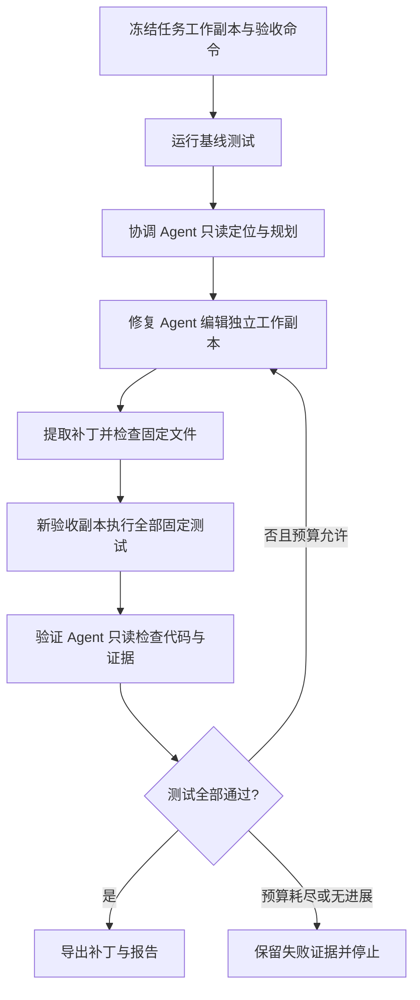

# 可验证的多智能体代码修复

本轮实现复用通用 Coding Agent、AST 检索、Skill 和 SQLite Memory，增加独立的修复入口。
通用 ReAct、Plan、Team 仍使用原有执行方式；**只有 `repair` 路径使用这里的容器隔离和固定验收**。

## 使用

需要可用 Docker、Python 3.11+ 和有效模型配置。先在宿主机拉取或构建执行镜像：

```bash
docker pull python:3.11-slim
uv run yecoding repair "修复指定问题" --cwd /path/to/project \
  --test "python -m unittest discover -s tests -v" --json
```

`--test` 可以重复，所有验收命令都通过才接受候选。命令由调用者在开始前指定，Agent 不能替换。
镜像必须已经包含项目所需依赖；默认镜像包含 Python 标准库，不包含 pytest 或项目依赖。
使用自建镜像时增加 `--image your-image:tag`。容器内禁网，不在运行时安装依赖。

模型配置从目标项目、用户配置及环境加载。对临时示例目录运行时，需要在环境或用户配置中提供 Key。
不需要将 Key 写进临时项目或镜像。

最终状态 `verified` 表示候选通过了指定验收，并导出 `candidate.patch`；其他状态返回非零 CLI 退出码。
原工作区保持原样。应用补丁前请核对源文件版本、补丁内容和测试覆盖范围。

项目配置示例（`.yecoding/config.json`）：

```json
{
  "repair": {
    "image": "python:3.11-slim",
    "test_commands": ["python -m unittest discover -s tests -v"],
    "max_attempts": 3,
    "max_llm_calls": 36,
    "max_tokens": 60000,
    "timeout": 900,
    "command_timeout": 60,
    "artifacts_dir": "~/.yecoding/repairs"
  }
}
```

配置完成后，REPL 使用 `/repair <task>`；SDK 使用：

```python
from yecoding.sdk import create_default_engine
from yecoding.config import RepairConfig

engine = create_default_engine("/path/to/project")
report = engine.repair_complete(
    "修复指定问题",
    options=RepairConfig(test_commands=["python -m unittest discover -s tests -v"]),
)
print(report["status"], report["artifacts"])
```

Runtime turn 和后台任务支持 `"mode": "repair"`，验收命令使用服务启动配置中的
`repair.test_commands`。验收失败产生错误，不能被 Runtime 标为成功完成。
Runtime 的既有项目作用域、租约和取消后拒绝迟到结果的规则继续生效。

## 执行与验收



三个角色使用独立对话历史和 Skill 缓冲区。协调/验证角色只有文件与代码检索工具；
修复角色额外获得编辑工具与容器 shell。该路径不注册 MCP、网络、恢复快照、任意记忆写入或技能写入工具。
工作副本的写入与容器 shell 由调用 `repair` 授权，原会话的权限配置不被更改。

基线已经通过时返回 `baseline_passed`，表示没有建立待修复问题，不能作为修复成功。
其他终止状态包括 `attempts_exhausted`、`no_progress`、`budget_exhausted`、`environment_error`、
`timeout`、`canceled` 和 `error`。模型文字中的“通过”不影响固定测试的判定。

每个命令使用独立容器：禁网、非 root、只读根文件系统、无额外 capabilities、无 Docker socket、
512 MB 内存、1 CPU、128 进程限制和临时 `/tmp`。容器仅挂载任务副本，验收阶段挂载为只读。
不透传宿主环境变量；标准位置的 `.env*`、私钥扩展名、Git 元数据和本地运行目录不进入快照。
超时或取消会移除命名容器，杀死其中的后台子进程。

原始验收测试、`conftest.py`、`pytest.ini`、`pyproject.toml`、`setup.cfg`、`tox.ini`
属于固定文件：文件写工具拒绝修改；shell 修改这些文件后，候选补丁同样被拒绝。
当前不支持修复这些文件；新增测试也需要放在后续人工审查流程中。
符号链接、特殊文件、二进制补丁以及过大的快照会被拒绝。

## Skill 与 Memory

三个内置 Skill 分别约束问题复现、最小修复、回归验证。使用既有发现机制，并记录实际加载的
名称、版本、角色和内容 SHA256。已有用户/项目覆盖与禁用状态仍有效。

记忆召回使用原项目作用域，不使用临时目录作为项目标识。自动写入的 `repair` 记忆仅包含
任务摘要、源快照指纹、修改文件、验收命令、补丁哈希及报告位置，30 天过期。
这代表候选通过指定测试，不代表补丁已应用或经验具有普遍正确性。
召回此类记忆时要求源快照指纹一致，避免直接使用已失效的经验。
记忆模块关闭时不读写；记忆存储故障作为警告记录，不覆盖真实测试结果。

## 运行证据和预算

每次运行保存独立目录，含 `report.json`、`events.jsonl`、各轮补丁和成功候选补丁。
报告记录源文件哈希、基线、各轮测试退出码与输出、角色意见、调用数、usage 和耗时。
证据可能包含项目源码片段，默认保存在本地，不自动上传或提交。

调用次数在每次模型请求前检查；token 阈值依据模型返回的 usage，在下次请求前检查，
最后一次请求可能超过阈值。模型未返回 usage 时以调用次数和总超时兜底。
总时限包含模型调用、工具执行与测试；容器清理可能使实际退出略晚于时限。

## 局限

- 固定验收通过只说明指定行为通过测试。评测额外使用模型不可见的测试检查错误验收。
- 容器共享宿主内核；这里没有提供虚拟机级隔离，也不保证抵抗恶意代码利用内核漏洞。
- 验收目录为只读，要求测试把临时文件写到 `/tmp`；需要直接修改仓库的测试须先适配。
- 当前为顺序角色协作，只有一个修复写入者；未实现并行写入、补丁合并和自动冲突解决。
- CLI、SDK、REPL 和 Runtime 的修复路径共享实现；普通 Team 的文字 Reviewer 不等于本流程的固定验收。

## 演示与实验

```bash
uv run python eval/prepare_repair_demo.py --out /tmp/yecoding-repair-demo
uv run yecoding repair "修复变量缺省值未生效的问题" \
  --cwd /tmp/yecoding-repair-demo/src \
  --test "python -m unittest discover -s tests -v" --json

# 不调用模型，真实验证原始源码通过、每个注入缺陷失败
uv run python eval/run_repair_eval.py --split all --out eval/results/repair-fixtures.json

# 真实模型对比：每组独立开始，禁用跨任务记忆；支持 --no-skill 消融
uv run python eval/run_repair_eval.py --live --split heldout \
  --strategies single,team,verified --out eval/results/repair-comparison.json

# 包含真实 Docker 的回归
YECODING_TEST_DOCKER=1 uv run --extra dev python -m pytest tests/test_repair.py
```

任务来自固定 python-dotenv v1.1.1 源码快照，2 个开发任务、8 个保留评测任务。
缺陷为人工注入，不是历史 issue，也不是 SWE-bench。验收测试为本项目编写。
评测确认未修改上游代码同时通过验收和额外测试；所有缺陷必须能触发真实测试失败。
额外测试在模型执行结束后才加入独立目录，不向 Agent 提供结果。

三组均使用相同容器和固定验收：`single` 只有修复角色并使用测试反馈；`team` 有协调/验证角色，
重试使用代码评审意见，验证角色不接收新一轮自动测试结果；`verified` 同时使用评审和执行证据。
这是受控反馈消融，不等同于直接运行原有通用 `--mode team`。
报告包含验收成功数、额外测试通过数、错误验收数、包含失败任务的平均 token 与耗时。
小样本、单次执行和人工注入缺陷不能支撑对真实历史问题的普遍提升结论。
