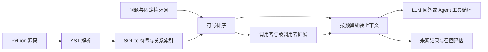

# 结构感知代码上下文管理：方法章节工作稿

## 2026-10-30：多轮工具证据管理实现

当前研究问题调整为：多轮代码任务中，能否减少工具证据在后续请求中的重复携带，
同时保持任务解决能力。下文 AST 解析、检索和打包属于已有基础能力，不计作新增贡献。

`ContextPolicy.prepare` 接收消息历史、任务、系统提示词、工具定义及预算，返回
`PreparedContext(request_messages, history_messages, stats, decisions)`。
默认 legacy 直接委托原压缩器，并保留其历史更新语义；evidence 保留完整原始历史，
仅将选择后的请求视图交给模型。两条 Agent 查询路径使用同一接口，模型和工具执行顺序不变。

每个工具结果记录调用 ID、内容哈希、顺序与错误状态；结构化读取额外记录来源文件、行段、
实际读取字节的版本哈希和可验证的 Python 符号。普通命令结果保持命令来源，不从任意输出猜测文件。
文件版本变化时旧源码标为过期；相关结构在选择时从当前文件重新解析。

默认以 16,000 个估算 token 组织工具证据，优先最近完整工具回合，并按最新失败、当前修改
相关符号与近似依赖、任务词匹配、时间顺序处理其余结果。结构关系只用于文件/工具证据优先级，
不是完整运行时调用图，也不声称已经实现按符号任意切片的最优选择。
重复结果保留一份正文和可定位引用；受额度约束的日志优先保留末尾错误及头部，
决策记录原输出的保留/省略行段。近期保护与必要说明可能导致软额度超出，超出量如实记录；
实际模型窗口仍由相同配置约束，无法容纳时明确报 context_overflow。

完整历史不因选择而丢失；单次查询中的来源状态不等于长期记忆或跨进程持久化的证据库。
该方法不调用额外摘要模型。去结构信息和去重消融保持相同额度与执行环境。
现有测试与真实 CLI 已验证接口行为；方法效果须由新的三线端到端实验判断，目前没有该结果。

## 已有结构检索与打包基础

本工作稿描述当前可运行实现，可据此扩展毕业论文的方法章节。实现范围为 Python
代码库；其他语言的文本索引不等于其结构解析能力。研究问题是：在相同代码上下文预算下，
结构检索与调用关系扩展能否增加相关符号的覆盖，同时保持回答质量。

## 系统流程



代码结构上下文与会话历史压缩是两个独立层次。`rag/context_builder.py` 选择仓库代码；
`context/manager.py` 压缩对话历史。论文应分别说明，不能把会话摘要算法当作代码检索方法。

## 解析与索引

`rag/parser.py` 用标准库 AST 访问文件、类、函数、方法和模块/类级简单赋值，记录路径、
限定名、类型、定义起止行、签名、docstring 和父作用域。关系包括 import、call 和 inherits。
语法解析失败时，索引仍保留文本行供文本搜索使用。

`rag/code_index.py` 使用三张主要表：`symbols` 存储符号，`edges` 存储关系，
`code_chunks` 存储非空文本行。记录由项目 root 隔离。调用目标的解析采用同文件唯一候选、
全局唯一候选和 `self` 成员/基类查找等规则；无法解析的关系保留为空目标。

这些规则产生静态近似图，并非运行时精确调用图。当前实现不完整处理 import 别名、
动态绑定、实例变量类型和多继承 MRO；文件名形成的限定名也可能重名。评测入口对真值符号
要求唯一匹配，遇到缺失或歧义直接报错，避免静默缩小召回分母。

## 检索与依赖扩展

`CodeIndex.ranked_symbols` 对查询词在符号名、限定名、签名和 docstring 中的匹配累加打分。
精确名称匹配权重最高，子串及文档匹配较低。这是结构字段上的词面检索，未使用 embedding。
默认保留前 8 个符号，对各符号检索直接调用者和被调用者，每个方向最多 12 个。
因此当前“调用链”是一跳关系展示，尚未构建任意深度的依赖闭包。

## 固定预算组装

优先级依次为：匹配符号签名、调用关系及依赖签名、源码摘录、文件摘要。预算使用
`estimate_text_tokens` 估算，支持中英文混合文本；它不是模型供应商的精确 tokenizer。
组装器最低预算为 128，预留 96 个估算 token 用于外层标签。评测命令拒绝更小的预算。

默认只检查排序列表前 3 项以选取源码，单项最多 40 行；超长源码在行边界截取并注明
遗漏行数。文件符号或变量不会提供函数源码，但当前仍可能占据这 3 个候选位置。
源码块放不下时停止该阶段；低优先级摘要仍可利用剩余空间。
文件摘要取模块 docstring 第一行，没有 docstring 时明确标注，不调用模型生成摘要。

```text
输入：查询 q，预算 B，索引 I，是否扩展依赖 expand
B ← max(B, 128)
剩余预算 ← B - 96
S ← ranked_symbols(I, q, limit=8)
按排名尝试放入 S 的路径、签名与定义位置
若 expand：尝试放入直接调用者/被调用者的关系和签名，并去重
对 S 的前 3 项：
    若为类、函数或方法，读取最多 40 行源码
    块能放下则纳入，否则停止源码阶段
按已纳入符号涉及的文件，尝试放入模块摘要
返回上下文文本、预算估算、截断标志和来源跨度
```

这个策略优先提供接口和依赖，但不能保证提供所有关键分支或完整函数体；固定前缀摘录
以及宽泛符号匹配会影响回答正确性。实验需同时报告符号召回和定义区间行覆盖率。

## 原型集成与消融

REPL 的 `/index` 构建索引，`/context` 生成预算化上下文；Agent 可调用只读工具
`get_context`。模型是否调用该工具由实际工具循环决定，不应描述为每次请求都会自动检索。

评测中的 `symbol_no_deps` 仅关闭调用关系阶段，保留相同检索排序、签名、源码和摘要规则。
省下的预算可用于后续阶段，因此这一消融衡量关闭依赖阶段的整体影响，不能完全隔离
依赖信息与预算重新分配的贡献。

公开原型可以演示仓库问答和函数解释；当前固定评测集属于代码理解任务。
尚无自动验证的 bug 修复或补丁成功率，不能把问答评分写成代码修复能力的实验证据。
