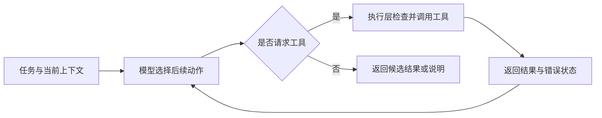

# 第2章 相关技术

编程智能体的执行过程涉及模型决策、工具交互、代码上下文和运行环境等多个层次。模型根据输入信息选择后续行动，工具将行动落实为文件操作或命令执行，外部结果再成为下一轮决策的依据。面向代码修复时，还需要组织不同角色的上下文，管理可复用流程与历史经验，并限制代码执行范围。本章介绍这些技术的基本原理及其在本文中的作用，为后续需求分析与系统设计提供基础。

## 2.1 大语言模型与工具调用

### 2.1.1 模型输出与外部执行

大语言模型根据输入上下文生成输出。在编程任务中，输出既可以是自然语言解释和代码文本，也可以是结构化的工具调用请求。工具调用通常包含工具名称、参数和调用标识，由程序侧的执行器解析并处理。例如，模型可以请求读取某个文件，执行器检查请求后返回文件内容；模型再结合返回结果决定是否检索其他位置、编辑代码或运行测试。

在这一过程中，模型负责提出动作，执行器负责落实动作。工具名称和参数描述向模型说明可用能力，而路径范围、执行权限、超时及错误处理由程序实现。参数看起来符合预期，并不意味着动作可以被直接执行：执行层仍需检查工具是否存在、必要输入是否齐全，以及当前任务是否允许调用该工具。

SWE-agent 将仓库导航、编辑和测试等交互纳入面向软件工程任务的接口设计，说明工具接口是编程智能体执行环境的重要组成部分。[@yang2024sweagent] 本文在已有工具抽象上组织文件读取、代码检索、编辑和命令执行能力，使模型能够通过一致的调用方式与仓库交互。

### 2.1.2 工具结果与消息关联

一次模型响应可以包含普通文本，也可以包含一个或多个工具调用。为使后续请求能够识别动作与结果之间的关系，系统需要保存调用标识，并将结果对应到原始调用。结果应当包含执行内容和错误状态；对于命令，还需要记录退出码、超时信息和必要输出。

流式接口可能将工具名称、参数文本和用量统计拆分到不同事件中，应用层需要先重组完整请求，再交由工具执行器处理。若参数无法解析或工具执行失败，错误信息同样应作为可观察结果返回，使模型能够调整操作。此类失败不能被替换为虚构的成功内容，否则后续推断将建立在错误的仓库状态之上。

工具调用成功与修复任务完成处于不同层次。文件写入成功只说明目标内容已经写入；测试命令的运行结果则反映候选在指定条件下的程序行为。系统需要在工具执行之外设置任务验收规则，使动作完成、候选产生和任务通过具有不同含义。

### 2.1.3 上下文窗口与预算管理

模型请求能够容纳的内容受到上下文窗口约束。系统指令、会话历史、工具定义、代码片段、召回经验和输出预留都会占用预算。为说明请求资源的组成，可将其概括为：

$$
B_{\mathrm{prompt}} + B_{\mathrm{history}} + B_{\mathrm{tools}}
+ B_{\mathrm{evidence}} + B_{\mathrm{output}} + B_{\mathrm{reserve}} \leq W
$$

其中，$W$ 表示上下文窗口；各项分别表示指令、历史、工具定义、任务证据、输出预留和额外保留空间的 token 预算。该表达式用于说明资源分配关系，实际请求还需要考虑模型的编码方式与消息序列化开销。

较长上下文不等于相关信息一定被有效使用。Lost in the Middle 在其评测任务中观察到，相关信息的位置会影响模型表现，为选择上下文和控制输入规模提供了研究动机。[@liu2024lostmiddle] 对编程智能体而言，可以从两个方面控制上下文：一是检索与当前问题相关的代码，二是压缩较早的会话内容。两者分别处理仓库信息和交互历史，不能混为同一种机制。

本文使用估算 token 数辅助代码片段组装和会话压缩，并保留近期消息及工具交互关系。请求前的估算服务于上下文控制，模型返回的 usage 服务于调用消耗记录；估算值不作为供应商实际计费用量的替代。

## 2.2 ReAct 编程智能体执行机制

### 2.2.1 行动与观察循环

ReAct 将任务推理与环境行动交替组织，使模型能够根据外部观察调整后续行为。[@yao2023react] 在编程场景中，外部观察可以是源码、搜索结果、文件修改结果或测试输出。一个典型过程是先读取实现，再定位相关调用方，随后生成修改，并根据执行结果决定下一步操作。

为描述这一交互关系，设第 $t$ 轮的任务指令为 $I_t$，交互历史为 $H_t$，可用工具集合为 $\mathcal{T}_t$，则可表示为：

$$
a_t = \pi_{\theta}(I_t, H_t, \mathcal{T}_t), \qquad
o_t = E(a_t), \qquad
H_{t+1} = H_t \oplus (a_t, o_t)
$$

其中，$a_t$ 为模型选择的动作，$E$ 为执行器，$o_t$ 为返回结果，$\oplus$ 表示将动作与结果加入历史。$\pi_{\theta}$ 仅表示模型在当前上下文下的决策过程，不意味着本文对模型参数进行训练。若模型返回普通回答而不再请求工具，本轮工具循环可以结束；候选是否通过任务验收仍由外部流程判断。

图2-1 工具驱动的智能体交互循环

### 2.2.2 工具调度与副作用控制

多个工具请求可能具有不同的执行依赖。读取两个互不影响的文件，可以在允许并发的条件下同时进行；先写文件再读取该文件，则需要保持顺序。若任意并发执行同一批请求，模型所观察到的内容可能与其预期的操作顺序不一致。

因此，工具系统需要同时描述工具功能与执行属性，包括是否只读、是否允许并发、危险程度和超时限制。本文已有执行器仅对相邻且声明为并发安全的只读调用进行并发处理，遇到写入或其他不满足条件的操作时保留顺序。这是工具调度层的规则，不等于多个修复角色可以同时修改同一工作区。

对于运行时间较长的任务，执行层还需要限制循环轮次与工具耗时，并把异常返回到可追溯的结果中。任务级控制则进一步考虑总调用数、总时限及是否持续产生有效修改。工具循环与任务流程分别承担动作执行和任务组织职责，使普通文字回答不会直接替代修复验收。

## 2.3 多智能体角色分工与上下文隔离

### 2.3.1 角色与协作方式

多智能体系统可以通过角色指令、工具集合和消息传递组织多个决策上下文。AutoGen 提供了基于可配置智能体对话构建应用的思路，为这种协作方式提供了参考。[@wu2024autogen] 在工程实现中，不同角色可以调用同一模型服务，而通过各自的历史、任务目标和可用工具承担不同职责，无须将角色数量等同于模型数量或操作系统进程数量。

代码修复中的职责可划分为任务组织、修改实现和独立检查。协调角色帮助明确步骤与范围，修复角色根据任务和证据进行编辑，验证角色检查候选及执行结果。各角色之间既可以并行分析，也可以顺序交接；具体方式取决于任务依赖和写入冲突。本文的修复流程采用顺序交接，由一个修复角色持有写入职责。

### 2.3.2 上下文与权限的分别约束

上下文隔离使角色只接收完成自身职责所需的信息，减少无关历史和其他任务指令的影响。交接时可以传递计划、补丁、变更文件和测试报告，而不是复制此前所有对话。各角色还应拥有独立的临时指令缓冲区，避免某个角色消耗另一个角色已经加载的技能内容。

上下文隔离和工具权限属于不同约束。角色提示词能够描述职责，但实际可执行动作取决于程序向其注册的工具。例如，只读检查角色应通过受限工具集合获得读取能力，而不是仅在提示词中要求其保持只读。这样才能使职责划分与执行边界对应。

独立对话历史也不意味着判断在统计上相互独立。不同角色使用同一模型、相同源码或相似指令时，仍可能产生相关错误。因此，独立评审可以提供额外意见，实际测试结果仍需由受控执行器产生，并保留其来源。

### 2.3.3 协作开销与反馈交接

角色之间传递结果时，需要决定保留哪些证据。仅传递“修改已经完成”会丢失验证依据；传递全部历史则增加上下文开销。较合适的交接内容应围绕当前候选，包含修改范围、补丁标识、关键输出和未解决问题，使后续角色能够核对同一个对象。

多角色执行还会重复输入共同指令、工具定义和仓库信息，协调与检查本身也需要模型调用。即使每个角色的输入都受到限制，整个任务的总消耗仍可能增加。因此，协作效果需要同时依据任务完成情况与资源消耗评价。本文在后续实验中使用统一预算比较不同反馈策略，不将角色分工本身作为性能提升的证据。

## 2.4 Python AST 与仓库代码检索

### 2.4.1 代码结构表示

抽象语法树（Abstract Syntax Tree，AST）用树形结构描述源码中的语法组成。相比仅按行切分文本，AST 能够区分函数、类、参数、赋值、导入和调用等结构，并为符号记录附加定义位置、作用域及签名。在 Python 仓库中，这些信息可以帮助系统定位接口及其相关实现。

本文使用 Python 标准库解析源码，将文件、类、函数、方法和部分变量定义组织为符号记录，并提取导入、调用与继承关系。符号及关系保存在本地 SQLite 索引中，结合文本行索引提供查询入口。无法进行结构解析的文件仍可使用文本信息辅助定位。

Python 具有动态绑定与运行时修改等特性，仅依据静态语法不一定能确定调用目标。例如，相同属性名称可能对应不同实例类型，运行时赋值也可能改变实际执行对象。因此，本文索引中的调用关系属于静态近似，可用于扩展检索线索，不作为完整运行时调用图。

### 2.4.2 检索与预算化组装

仓库级任务需要选择与当前问题相关的代码。RepoCoder 将迭代检索与生成结合，为利用仓库上下文提供了相关工作基础。[@zhang2023repocoder] 本文采用符号字段上的词面匹配和文本搜索进行检索，没有引入向量数据库或训练新的嵌入模型。

检索得到候选符号后，可以附加相关调用者、被调用者及源码片段，再根据预算组织为输入。本文按符号签名、直接关系与相关签名、源码摘录、文件摘要的优先顺序组装上下文。签名提供接口线索，源码摘录提供具体实现，二者具有不同的信息粒度。

当预算不足时，组装器需要记录截断和来源范围。某个符号名称出现在上下文中，仅能说明其定义位置或接口信息被检索到；它不等于完整函数体已经提供，也不保证模型获得了决定问题的分支。后续结果分析应将检索覆盖和修复行为分别评价。

代码检索与会话压缩的关系如表2-1所示。

表2-1 代码上下文组织与会话压缩的区别

| 机制 | 处理对象 | 主要作用 | 需要保留的信息 |
| --- | --- | --- | --- |
| 代码检索与组装 | 仓库文件、符号和关系 | 选择当前任务需要的代码证据 | 文件路径、符号与源码范围 |
| 会话历史压缩 | 已发生的对话和工具结果 | 限制较早交互占用的上下文 | 近期操作、关键结果及调用关联 |

本文通过既有工具向智能体提供结构上下文，是否需要继续读取完整文件仍由当前任务决定。检索主要支撑问题定位，最终修改是否满足要求由执行验收判断。

## 2.5 Skill 流程知识与 Memory 经验管理

### 2.5.1 工具、Skill 与 Memory 的区别

工具、Skill 和 Memory 都参与智能体执行，但承担不同职责。工具提供可被调用的操作；Skill 描述特定任务的处理步骤、适用条件和完成要求；Memory 保存与项目或历史任务相关的数据。本文采用这一划分组织流程知识和经验信息，如表2-2所示。

表2-2 工具、Skill 与 Memory 的职责比较

| 组件 | 核心内容 | 典型示例 | 生效方式 |
| --- | --- | --- | --- |
| 工具 | 程序操作及参数接口 | 读取文件、编辑源码、执行命令 | 由执行器检查并调用 |
| Skill | 可复用的处理流程 | 问题复现、最小修复、回归检查 | 作为任务上下文提供给模型 |
| Memory | 具有来源与适用范围的数据 | 测试入口、历史失败原因、已验证候选记录 | 按作用域召回并重新判断适用性 |

Skill 可以指导模型选择操作步骤，但不会自行赋予工具权限；Memory 能够提供线索，但不能直接替代当前任务的执行证据。三者分别对应操作能力、流程指导和经验数据，需要在程序中建立明确的使用边界。

### 2.5.2 Skill 的发现与指令注入

当技能数量增加时，将所有正文长期放入提示词会占用上下文。可以先通过名称、描述和标签暴露简要信息，在匹配任务或确定角色职责后加载所需正文。技能的版本、来源和启用状态也需要被记录，以便解释一次任务实际采用了哪些流程要求。

本文已有技能系统支持内置、用户和项目三个层次，同名技能按层次覆盖，并通过名称、描述和标签进行匹配。通用工具循环可以按需加载技能；专门的修复流程则根据角色预先选择复现、最小修复和验证技能，在角色启动时注入对应内容。

技能缓冲区在注入时被消费，避免框架在后续轮次重复追加同一段正文；已经进入消息历史的内容仍受会话管理机制处理。每个角色使用自己的缓冲区，使指令注入与角色上下文对应。版本与内容指纹能够说明任务实际使用的技能内容，供后续运行核对。

### 2.5.3 短期上下文与长期经验

短期上下文保存当前任务中的对话、工具动作和返回结果，其生命周期主要对应一次执行过程。长期经验则需要跨任务保存，并在后续请求中按相关性选取。Reflexion 研究了将任务反馈转化为文本反思并用于后续尝试的方式，为反馈保留与使用提供了参考。[@shinn2023reflexion] 本文的长期记忆是应用层经验存储，不涉及模型参数更新。

本文采用 SQLite 管理动态记忆，为条目保存作用域、类型、来源、时间、重要性和置信度等属性，并进行去重、过期处理与容量限制。召回通过词面相关性结合重要性、置信度、时间及访问情况进行排序。置信度在这里是条目管理属性，不是经过统计校准的正确概率。

对于修复经验，适用性还受到源码状态和执行环境影响。临时目录适合隔离一次任务，却不适合作为长期项目身份，因此本文以原项目作用域召回经验。自动保存的修复记录附带源码指纹、补丁与验证报告的关联信息，并设置有效期；修复流程召回此类记录时检查源码指纹。指纹一致仍不能替代当前环境中的重新验证，经验中保存的候选也不表示原仓库已经应用该补丁。

## 2.6 容器隔离与资源约束

### 2.6.1 容器执行的基本原理

容器通过操作系统提供的隔离与资源管理机制运行进程。Docker 官方文档将命名空间、控制组和权限配置列为其安全与资源管理机制的重要组成部分。容器共享其所在运行环境的内核，其边界还取决于挂载、用户权限和 Docker daemon 等配置。[@dockerSecurity]

对于编程智能体，容器可以提供预先准备的解释器与依赖环境，并将命令执行限制在指定挂载范围内。模型访问凭据由宿主应用管理，代码执行容器只接收运行所需的少量环境配置。这样能够分别组织模型调用与程序执行，减少执行环境对宿主状态的直接依赖。

容器隔离并不等同于独立虚拟机，也不能自动保证任意配置都安全。是否允许网络、是否挂载宿主目录、以何种用户运行以及是否获得额外 capabilities，都会影响实际边界。本文根据修复任务需要限制这些配置，具体参数在实现章节说明。

### 2.6.2 文件变更与执行范围

为保护用户原仓库，首先需要建立任务工作副本。文件修改发生在副本中，候选通过验收后导出为补丁，用户原目录不会因任务过程直接被覆盖。在此基础上，容器仅挂载专用任务目录，用于执行命令。二者的职责分别是隔离代码变更和约束代码执行，不能相互替代。

宿主侧文件工具同样需要路径检查，以防止请求跳出任务目录或通过链接访问其他位置。验收阶段还需要保持固定测试与关键配置的边界，避免候选通过移除测试或改变验收条件获得通过结果。主要机制及作用范围如表2-3所示。

表2-3 修复执行中的边界机制

| 机制 | 主要作用 | 不能单独保证的事项 |
| --- | --- | --- |
| 任务工作副本 | 隔离文件变更，形成候选补丁 | 任意 shell 对宿主环境的影响 |
| 路径与文件类型检查 | 限制宿主文件工具的访问范围 | 容器内命令的全部行为 |
| 容器、挂载与权限配置 | 限制进程可访问的环境与资源 | 程序逻辑正确性和全部内核风险 |
| 固定测试及其结果记录 | 检查约定行为，保留验收依据 | 未覆盖输入下的正确性 |

验收需要可写临时文件时，应使用明确允许的位置，使测试的数据写入需求与源码保护要求相协调。测试退出状态和输出属于执行证据，其可信范围仍受测试覆盖与环境条件限制。

### 2.6.3 资源限制与生命周期管理

容器默认不会自动获得适合任务的 CPU 和内存上限，需要显式配置资源约束。[@dockerResources] 编程任务除了正常测试，也可能出现无限循环、过量输出或持续启动子进程等情况，因此系统需要同时考虑 CPU、内存、进程数量、输出保留量和执行时间。

时间限制与资源清理相互关联。只停止等待命令结果，不一定意味着执行进程已经终止；只结束启动命令的客户端，也可能留下容器中的子进程。任务结束、超时、取消和异常退出都应进入明确的清理流程，对应地释放执行资源并保留终止原因。

命令级限制还需要与任务级预算结合。即使每条命令都在规定时间内结束，模型反复调用工具仍可能使任务长时间运行。本文分别记录执行结果与任务状态，用尝试次数、模型调用、token 阈值和总时限约束整个流程，为失败终止提供可检查的依据。

## 2.7 本章小结

本章介绍了系统所采用的相关技术。大语言模型与工具接口构成动作选择和执行基础，ReAct 循环将外部观察纳入后续操作；多角色上下文与工具权限分别约束职责信息和可执行能力；Python AST 与代码检索提供仓库定位线索；Skill 和 Memory 分别组织流程知识与带来源的经验；工作副本、路径检查和容器配置共同界定修改与执行范围。

这些技术需要在同一任务流程中配合，才能形成从问题输入、候选修改到执行验收的交付过程。下一章将据此分析系统使用场景、功能需求及资源和验收约束，随后给出总体设计与核心实现。
