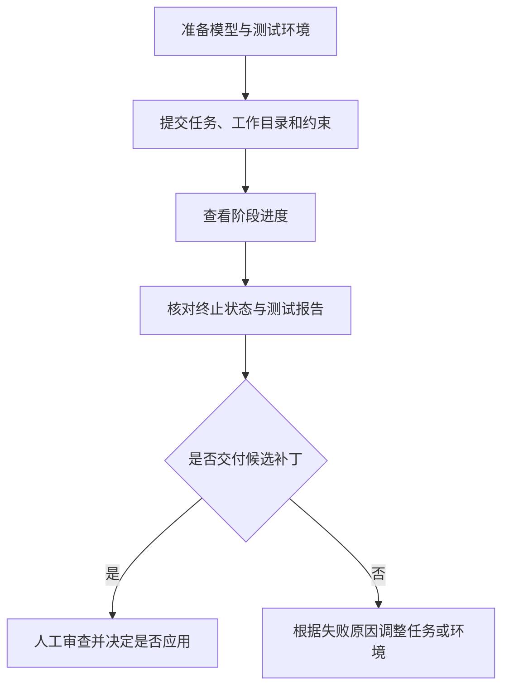

# 第3章 系统需求分析

本系统面向具有可执行测试的 Python 代码修复任务，在已有终端编程智能体基础上建立独立的协作与验证流程。本章依据目标使用场景和执行约束归纳需求，明确任务输入、功能职责、资源边界与验收条件。需求分析的重点是使修改过程和交付结果能够被检查，而不是要求所有任务都成功修复或预设多智能体优于单智能体。

## 3.1 用户场景与任务范围

### 3.1.1 目标使用场景

系统主要服务于三类使用场景。第一类是开发者通过终端描述一个已经能够复现的问题，希望系统帮助定位实现、生成候选修改并执行测试。第二类是程序化集成，由 SDK 或 Runtime 提交任务、读取结构化结果，并接入已有的任务管理流程。第三类是实验复核，使用固定源码、任务描述和执行预算比较不同策略，检查结果是否与补丁及测试证据一致。

这三类场景具有共同要求：调用者能够指定任务处理对象和验收条件，系统在明确范围内执行，结束后提供可判断的结果。交互式终端强调进度和结果可读性，程序化调用强调状态与字段的一致性，实验复核强调来源和执行条件的可追溯性。因此，核心修复流程需要复用统一实现，不同入口负责各自的参数组织与结果展示。

从调用者角度，业务过程如图3-1所示。系统产生候选补丁后，应用决定仍由调用者作出；人工审查与补丁应用不属于系统自动完成修复的隐含步骤。

图3-1 调用者使用系统的业务过程

### 3.1.2 任务输入与前置条件

一个修复请求需要同时描述期望行为和可执行约束。自然语言任务用于说明问题，工作目录确定待处理源码，验收命令定义判断依据，执行环境和资源预算限定运行条件。主要输入见表3-1。

表3-1 修复任务输入

| 输入项 | 含义 | 要求 |
| --- | --- | --- |
| 任务描述 | 待修复行为及期望结果 | 应能够关联到可观察的问题，不能为空 |
| 工作目录 | 待处理仓库的当前文件状态 | 使用独立副本执行修改，并记录来源指纹 |
| 执行环境 | Python 解释器与所需依赖 | 调用者预先准备可用容器镜像 |
| 验收命令 | 检查目标行为和回归的命令 | 至少提供一条，任务开始后保持固定 |
| 资源预算 | 尝试次数、模型调用、token 阈值与时限 | 使用正值，并能在配置中确定 |
| 交付位置 | 补丁、报告和事件记录保存位置 | 与被处理的源码工作区分离 |

系统以指定目录中的当前文件内容建立初始状态。仓库提交号能够提供版本背景，但目录中仍可能存在未提交修改，因此不能仅根据提交号判断任务实际使用了哪些源码。对于新增修复流程，需要保存本次快照的指纹，并将后续补丁与该来源状态关联。

模型服务和 Docker 执行环境是运行前提。镜像中应已经具备测试所需依赖；修复容器内部不依赖联网安装完成环境准备。缺少测试入口、镜像不可用或执行器无法启动时，系统应明确返回输入或环境问题，不应绕过限制转到宿主机运行模型生成的命令。

### 3.1.3 当前支持范围

本系统的重点是具有已知验收入口的 Python 源码修复。任务应能够先通过测试建立失败基线，再检查候选是否改变了相关行为。系统保留通用编程工具能力，但修复流程中的修改与执行只作用于专用任务副本。

当前协作方式为顺序交接，由一个修复角色负责写入。并行代码修改、自动合并冲突、多语言完整语义分析以及自动准备任意项目依赖均不属于本轮交付范围。对二进制补丁、符号链接、特殊文件和超出快照限制的输入，系统采用明确拒绝的方式处理。测试或关键配置本身需要修改的任务，也不属于当前固定验收规则下的修复对象。

## 3.2 编程智能体基础功能需求

### 3.2.1 仓库交互与工具执行

修复任务需要保留编程智能体的基本能力。系统应允许读取工作区源码、列出目录、搜索文本和进行受控编辑，并能够执行测试或辅助诊断命令。不同操作应通过一致的工具接口组织，使模型能够识别输入要求、接收执行结果，并在失败时获得可继续处理的信息。该需求记为 FR-01。

文件修改和命令执行具有副作用，因此工具调用应受到执行层约束。模型请求不存在的工具、遗漏必要参数或访问越界路径时，执行器应返回错误，不能把请求直接解释为成功。对于多个调用，还应根据操作之间的依赖保持必要顺序，使读取到的状态与此前写入相对应。

### 3.2.2 代码定位与上下文获取

为了定位问题，系统需要提供基于文本和代码结构的检索能力。模型应能够查询相关符号、读取定义范围，并根据需要继续检查调用位置或完整文件。已有的 AST 索引和预算化上下文组装作为定位支撑，检索结果应保留文件与行号来源，便于后续核对。该需求记为 FR-02。

上下文获取还应考虑输入规模。较长文件或会话历史不能无限累积，必要时需要进行截断、摘要或按预算选择内容。由此产生的信息范围变化应能够被识别，避免将接口签名命中当作完整实现已经提供。检索的作用是辅助定位，最终修复结论仍需结合实际测试。

### 3.2.3 多入口调用与配置

系统应提供终端命令、交互式请求和程序化调用方式，使同一修复流程能够用于人工操作和任务集成。任务描述、验收命令和预算可以通过各入口允许的参数或项目配置提供，但不能因入口不同而改变核心验收含义。该需求记为 FR-03。

程序化调用需要显式读取结果状态；命令行需要用可读输出和退出状态区分成功与未完成。Runtime 还应保留既有任务作用域与取消语义，防止已取消任务被迟到结果覆盖。入口一致性指核心流程和结果含义一致，不要求各接口具有完全相同的参数形式。

## 3.3 多智能体代码修复需求

### 3.3.1 初始状态与失败基线

系统应在模型修改前建立任务副本，并执行调用者提供的固定验收命令。源码状态、命令与结果共同构成本次修复的起点。只有确认基线存在测试失败，后续修改才具有可以对照的修复目标。该需求记为 FR-04。

若基线已经全部通过，系统应说明当前验收未建立待修复问题，而不是将其当作本次修复成功。若基线受到镜像、运行器或超时问题影响，则应保留执行未完成的原因，不将其直接解释为代码缺陷。这样能够避免在环境条件不明确时进行缺乏依据的编辑。

### 3.3.2 角色职责与候选交接

系统需要区分协调、修复和验证职责。协调角色只读检查任务并组织步骤，修复角色根据证据修改实现，验证角色检查候选及相关结果。不同角色应使用各自的对话历史与技能缓冲区，并通过程序提供与职责对应的工具集合。该需求记为 FR-05。

交接内容需要围绕同一候选展开。系统应能够关联初始状态、修改文件、补丁、测试结果和检查意见，使后续角色可以核对“检查的对象是什么”和“结论依据是什么”。仅传递完成性文字不足以满足交接要求；同时，不应无条件复制全部历史，使协作开销失去控制。

### 3.3.3 固定验收与反馈重试

候选产生后，系统应在验收副本中执行全部固定命令，根据真实退出状态和超时信息判断是否通过。验证角色可以提供解释和建议，但其通过意见不能覆盖实际测试失败。测试文件及关键配置在支持范围内应保持固定，候选也不能通过删除测试或放宽条件取得验收结果。该需求记为 FR-06。

当测试失败且预算允许时，系统需要将失败证据传递给修复角色继续处理。反馈应指向当前候选，而不是只重复原始问题。若候选违反固定文件规则，应明确说明被拒绝的原因；若连续提交相同补丁或没有有效变更，应识别为无进展，避免反复消耗资源。该需求记为 FR-07。

受控重试意味着允许继续修复，也意味着存在明确停止条件。尝试次数、模型调用、token 阈值与总时限应共同约束执行。环境异常、预算耗尽和总超时等终止状态应分别保留，不能通过忽略失败或重置预算将其转化为成功。

### 3.3.4 候选交付与失败记录

流程成功时，系统应导出候选补丁及对应报告，并说明原仓库尚未被自动应用修改。补丁需要能够与来源状态及验收结果关联，供调用者进一步审查。任务已经建立运行目录后，即使最终失败，也应尽可能保存已有测试、候选和终止原因。该需求记为 FR-08。

候选通过某组测试与任务成功交付需要分别记录。如果流程在检查或交付完成前耗尽预算，应保留已经获得的候选证据，但仍以实际终止状态报告。此项要求既服务于使用者，也使实验能够区分代码行为与流程完成情况。

## 3.4 Skill 与 Memory 管理需求

### 3.4.1 可复用流程知识

复现、修改和验证包含可以复用的操作步骤。系统需要通过 Skill 保存这些流程，提供名称、描述、来源、版本和启用状态，并按任务或角色加载正文。不同角色的技能注入应保持独立，运行记录应能说明实际使用了哪些内容。该需求记为 FR-09。

修复流程中的 Skill 负责指导如何分析和检查，不改变执行器的权限边界。技能内容可随任务进入上下文，但不能因此获得宿主命令、任意写入或改动验收规则的能力。对于内置、用户和项目层次的同名技能，应遵守已有覆盖与启用规则，使一次运行使用的版本可以被追溯。

### 3.4.2 项目经验与适用条件

系统需要按项目保存与召回可复用经验，避免将临时工作目录当作长期项目身份。经验条目应包含来源、类型、时间及有效性信息；自动记录的修复经验还应关联源码指纹、候选补丁与验证报告，使后续使用能够检查其适用条件。该需求记为 FR-10。

经验应作为辅助数据提供给模型，不直接替代当前测试。未通过验收的尝试不能自动被记录为成功修复规则；已经通过验收的候选，也只能说明其在当时指定条件下的结果。源码状态发生变化后，修复流程应过滤不匹配的自动经验，环境差异则仍需重新执行验证。

Memory 关闭时，应停止相关读写；技能或经验内容也不能跨角色、跨项目无约束混入。记忆存储不可用时，应记录警告，并保持测试结果原本的含义，避免辅助组件故障将已经获得的验收事实改写为另一种结论。

核心功能需求归纳如表3-2所示。

表3-2 核心功能需求汇总

| 编号 | 需求 | 核对重点 |
| --- | --- | --- |
| FR-01 | 仓库工具交互 | 读取、搜索、编辑与命令执行返回真实结果 |
| FR-02 | 代码定位与上下文获取 | 提供文本和结构线索，保留来源与范围 |
| FR-03 | 多入口调用与配置 | 核心流程一致，失败和未完成状态可识别 |
| FR-04 | 初始状态与失败基线 | 修改前记录来源并检查待修复问题是否成立 |
| FR-05 | 角色分工与候选交接 | 独立上下文、职责工具与候选证据关联 |
| FR-06 | 固定验收 | 使用真实测试结果，保护支持范围内的测试与配置 |
| FR-07 | 有限重试与无进展终止 | 反馈关联候选，执行受统一预算约束 |
| FR-08 | 补丁与运行证据交付 | 成功有候选与报告，失败保留已有证据 |
| FR-09 | Skill 流程管理 | 按角色加载，记录实际版本和内容指纹 |
| FR-10 | 项目 Memory 管理 | 按项目召回，检查自动经验的源码状态和有效期 |

## 3.5 隔离执行、预算与异常处理需求

### 3.5.1 修改与执行边界

修复过程中，模型能够提出具有副作用的动作，因此原仓库保护需要由程序侧落实。系统应限制宿主文件工具的访问范围，并将生成命令送入任务容器执行。容器仅获得任务所需的挂载和运行参数，不透传模型访问凭据；执行镜像不可用时应报告失败，不能自动放宽为宿主执行。

固定验收保护也具有明确范围。当前规则识别约定的测试目录、测试文件命名及部分关键配置，不能据此宣称已经覆盖任意项目的自定义验收脚本。使用者需要选择可信的命令与环境，并确认任务符合受支持约定。补丁自动应用、测试或构建配置修改等能力应与当前修复范围区分。

### 3.5.2 资源与时间约束

系统需要同时约束单次命令和整个任务。命令执行应设置 CPU、内存、进程数量、输出保留量与时间限制；任务执行则需要限制模型请求和修复尝试，避免通过大量短命令或反复调用模型持续占用资源。

token 控制采用模型返回的 usage，在下一次请求前检查累计值。因此，这一配置的含义是继续请求的阈值，最后一次响应可能使累计用量超过阈值。模型未返回有效用量时，还需要由调用次数、尝试次数和总时限提供约束。该需求不能被表述为对最终 token 总量的精确硬限制。

对于取消和超时，系统应进入资源清理流程，并保存已经形成的状态。清理可能使实际退出略晚于设定时限，不应为满足表面时间要求而留下后台进程。Runtime 接收取消后，需要依照既有任务状态规则拒绝迟到完成结果，而不承诺所有正在进行的调用都能瞬时终止。

### 3.5.3 可追溯性与可维护性

为支持问题复核，报告需要保存任务标识、模型配置中的非敏感信息、源码指纹、各轮候选、测试结果、调用消耗及终止原因。上述信息用于解释一次运行发生了什么，不等于能够保证模型再次产生完全相同的输出。

证据本身可能含有源码片段，因此保存位置应与源码输入分离，模型凭据和宿主私有运行数据不应被常规透传到执行环境。系统通过排除标准敏感文件位置和限制输入范围减少无关数据进入任务副本，但不能将其表述为识别仓库中所有秘密的自动检测能力。

可维护性要求核心执行与入口展示分离，使配置和验收语义能够复用。功能效果也需要与性能目标分开：系统以真实运行记录分析完成情况和成本，不规定未经实验支持的最低修复率、固定加速倍数或普遍协作收益。主要非功能需求见表3-3。

表3-3 非功能需求汇总

| 编号 | 需求 | 可检查条件 |
| --- | --- | --- |
| NFR-01 | 原仓库与路径边界 | 正常修复在副本中发生，越界访问和不支持文件被拒绝 |
| NFR-02 | 资源受控 | 命令与任务有明确限制，超时或取消后清理容器资源 |
| NFR-03 | 敏感信息边界 | 不透传模型凭据，输入快照排除约定的私有运行文件 |
| NFR-04 | 状态与证据可追溯 | 结果关联候选和执行记录，未完成状态不被报为成功 |
| NFR-05 | 配置与集成一致性 | 各入口复用核心流程，显式参数与项目配置具有可解释含义 |
| NFR-06 | 评估口径明确 | 成功、预算失败与额外测试结果分别统计，成本包含失败运行 |

## 3.6 任务验收与结果追溯需求

### 3.6.1 任务级验收条件

任务级验收应关注完整交付，而不是某个中间动作。首先，系统需要在来源状态上建立有效失败基线。其次，候选应具有实际变更，符合文件和测试保护规则。再次，固定命令需要在规定的验收环境中全部通过，且不能用角色文字意见覆盖失败。最后，系统应在约定流程内形成候选补丁和报告，并以明确状态交付。

这组条件将输入有效性、候选有效性、行为检查和流程完成联系起来。只完成文件编辑、只运行部分命令、仅获得评审通过意见或在交付前耗尽预算，都不足以作为成功结束依据。额外测试可以用于实验复核，但若它在运行结束后才加入，就不能反向改写原始流程当时的终止状态。

### 3.6.2 典型验收场景

系统验收需要同时覆盖正常流程和边界情况。表3-4给出可用于后续测试章节的主要场景，编号与功能需求保持关联。

表3-4 主要验收场景

| 编号 | 场景 | 应满足的条件 | 关联需求 |
| --- | --- | --- | --- |
| AC-01 | 未提供验收命令 | 明确提示输入问题，不开始模型修复 | FR-03、FR-04 |
| AC-02 | 初始测试全部通过 | 报告未建立待修复问题，不宣称产生修复 | FR-04、FR-06 |
| AC-03 | 首轮失败后生成有效修复 | 反馈关联失败候选，成功时输出补丁和报告，原仓库不自动修改 | FR-05—FR-08、NFR-01 |
| AC-04 | 角色称已修复但测试失败 | 真实失败结果不被覆盖，按预算继续或终止 | FR-06、FR-07 |
| AC-05 | 越界写入或修改受保护测试 | 对应工具操作或候选被拒绝，不能交付成功结果 | FR-01、FR-06、NFR-01 |
| AC-06 | 达到预算或没有新修改 | 以预算或无进展状态终止，保留已经形成的证据 | FR-07、FR-08 |
| AC-07 | 命令超时、任务取消或镜像不可用 | 明确未完成原因，清理已建立的执行资源，不回退宿主执行 | FR-08、NFR-02、NFR-04 |
| AC-08 | 技能与经验参与执行 | 加载内容可追溯，失效自动经验被过滤，Memory 关闭时不读写 | FR-09、FR-10 |
| AC-09 | 切换调用入口或收到迟到结果 | 核心验收语义一致，Runtime 不将失败或已取消任务改写为完成 | FR-03、NFR-04、NFR-05 |

这些场景属于可核对的功能要求，不直接代表修复质量实验已经获得相应收益。例如，经验能够被正确保存和过滤，可以证明管理机制符合预期，但不能单独证明它提高了未知任务的修复成功率。

### 3.6.3 实验与复核要求

在比较不同策略时，需要固定任务初始状态、执行环境、验收命令和预算设置，区分开发任务与保留评测任务。已知属于人工注入的缺陷应说明构造方法，不能改称真实历史问题。运行结果需要保留失败案例，并将平均调用消耗和耗时的分母与任务总数对应。

为检查固定验收的覆盖边界，可以在模型运行结束后对候选执行额外测试。此时应分别统计流程成功数和额外测试通过数，并说明后者是否对模型可见。对于小样本、单次运行或存在同机负载的耗时记录，应限制结论范围，避免从有限结果推导普遍质量优势或严格性能提升。

## 3.7 本章小结

本章围绕终端修复、程序化集成与实验复核场景，明确了任务输入和前置条件，归纳出仓库交互、失败基线、角色交接、固定验收、有限重试、交付记录及 Skill、Memory 管理等功能需求，并给出修改边界、资源约束和结果追溯方面的非功能要求。

需求分析强调，成功修复需要同时具备可检查的候选、实际验收依据和完整交付状态，失败与预算终止同样属于应被保留的系统结果。下一章将依据这些需求给出总体架构、模块职责、角色协作和数据组织设计。
