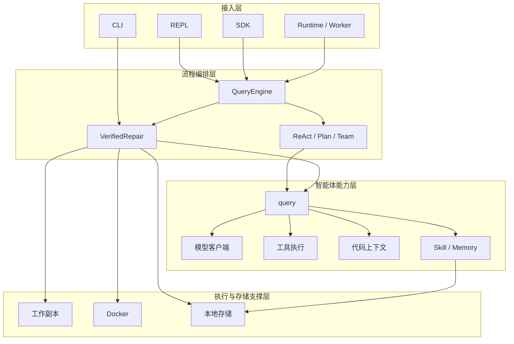
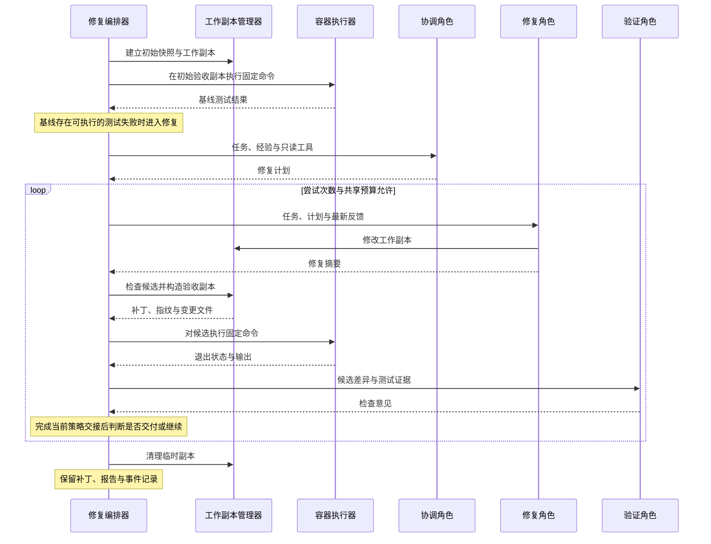
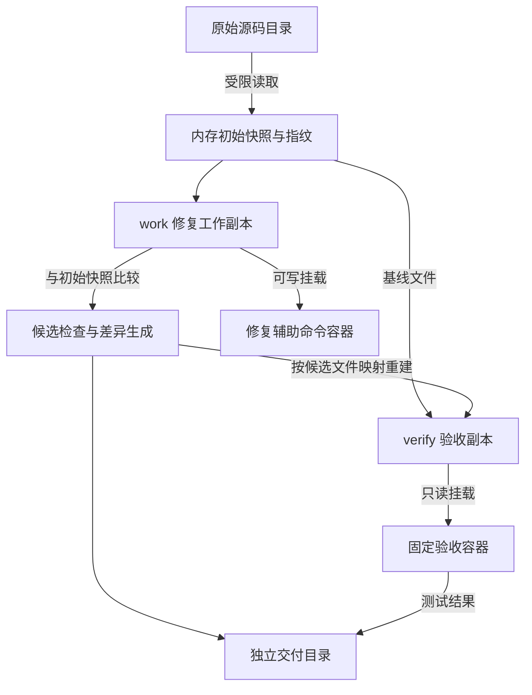

# 第4章 系统总体设计

第三章明确了代码修复任务的输入、角色职责、执行边界与验收条件。本章在这些需求基础上给出系统总体设计，说明既有编程智能体如何与专用修复流程衔接，以及任务上下文、候选文件、测试结果和交付物如何在模块之间流转。设计重点是建立从初始源码到候选补丁的证据关联，使协作过程能够被检查，并在资源或环境条件不足时保留明确的终止结果。

## 4.1 系统分层架构与模块职责

系统采用模块化分层组织，逻辑上划分为接入层、流程编排层、智能体能力层和执行与存储支撑层。各层运行于同一 Python 应用体系中，分层用于划分职责与依赖，不要求分别部署为独立服务。总体关系如图4-1所示。

图4-1 系统逻辑分层与主要依赖

接入层负责收集参数、展示进度和适配调用方式，不决定候选是否通过验收。流程编排层区分通用编程任务与受约束修复任务：前者保留已有交互方式，后者由 `VerifiedRepair` 统一控制基线检查、角色调用、候选验证和结束处理。智能体能力层提供模型交互、工具调用、代码定位和知识注入，减少不同执行路径之间的重复实现。支撑层负责临时文件、容器命令和本地记录。

主要模块与需求之间的对应关系见表4-1。这里的职责边界按实际实现划分，不额外引入消息中间件、远程调度服务或专用向量数据库。

表4-1 主要模块职责与需求对应

| 模块 | 主要职责 | 对应需求 |
| --- | --- | --- |
| 接入模块与 `QueryEngine` | 参数适配、选择执行路径、传递事件与结果 | FR-03 |
| `VerifiedRepair` | 基线、顺序角色交接、预算、重试与终止 | FR-04—FR-08 |
| `query` 与工具执行器 | 模型请求、工具调用与结果回填 | FR-01 |
| 代码索引与上下文模块 | 符号检索、源码定位、上下文预算管理 | FR-02 |
| Skill 与 Memory 模块 | 过程知识注入、项目经验召回和保存 | FR-09、FR-10 |
| `RepairWorkspace` 与 `DockerSandbox` | 文件副本、候选检查与受限命令执行 | NFR-01—NFR-03 |
| 报告、事件记录与 Runtime 任务管理 | 过程追溯、任务调度与结果适配 | NFR-04、NFR-05 |

## 4.2 通用编程能力与修复流程的衔接

### 4.2.1 共用能力与流程分离

系统保留通用 ReAct、Plan 和 Team 路径，新增 `repair` 路径承载论文研究的代码修复过程。几种路径共用模型客户端协议和工具调用循环，但任务完成条件不同。通用路径根据各自的交互和编排规则结束；修复路径必须检查固定验收命令，并输出与候选关联的结果。

这种划分使新增流程能够利用已有的文件工具、代码检索、提示词组装和用量统计，同时独立管理修复所需的执行约束。具体而言，`VerifiedRepair` 在每次角色调用时构建受限工具注册表，再调用已有 `query` 循环。修复角色不会直接取得通用会话中的全部工具，模型生成的命令被专用容器处理器接管。

配置采用副本传递。修复流程复制已有配置和修复选项，在副本中设置工作目录、路径约束及工具范围，避免改变原交互会话的策略。修复结束后，普通编程入口继续使用原有配置。原会话历史也不会被作为修复角色的共享对话历史直接接入。

### 4.2.2 核心流程与接入适配

`VerifiedRepair` 是各修复入口共用的核心实现。CLI 的 `repair` 子命令直接构造该对象；REPL、SDK 和 Runtime 通过 `QueryEngine.repair` 进入同一流程。因此，入口一致性通过共用修复编排器实现，并不要求所有调用都经过完全相同的适配函数。

编排器以异步事件方式报告进度和结果。终端可以消费文本增量，SDK 可以遍历事件或等待结构化报告，Runtime 则将其转换为自身的任务事件。这些展示差异不改变固定测试、候选检查和预算的含义。模型回复“已完成”仅是角色输出，必须由编排器继续处理后才能形成任务结果。

## 4.3 协调、修复与验证角色设计

### 4.3.1 角色能力与上下文边界

系统采用协调、修复和验证三个逻辑角色。角色由职责提示、工具集合、输入上下文和对应 Skill 共同定义，不要求三个独立模型或进程。当前流程复用同一模型客户端，由统一预算包装器累计各角色消耗。角色之间按顺序交接，只有修复角色能够修改业务源码，具体见表4-2。

表4-2 修复角色的能力与交接内容

| 角色 | 工作对象与工具范围 | 主要输入 | 交接内容 |
| --- | --- | --- | --- |
| 协调角色 | 修复工作副本；读取、搜索和代码上下文工具 | 任务描述、召回经验、项目规则 | 简短修复计划 |
| 修复角色 | 修复工作副本；读取、编辑及容器命令工具 | 任务上下文、计划、最新反馈 | 实际文件修改与文字摘要 |
| 验证角色 | 当前候选的验收副本；读取、搜索和代码上下文工具 | 任务、候选差异及策略允许的测试证据 | 检查意见与后续建议 |

只读角色不开放业务源码编辑和命令执行工具；索引构建等内部辅助操作可能产生技术缓存，因此这里的只读主要指业务文件的操作权限。所有角色均不获得修复流程以外的任意 MCP、网页访问或记忆写入工具。权限由工具注册和执行处理器落实，角色提示负责进一步说明行为目标。

每次角色调用创建独立的消息历史和 Skill 缓冲区。协调计划由程序提取后加入公共任务上下文；修复摘要、补丁和测试结果则进入本次尝试记录。重试时，新的修复调用读取保留的工作副本和最新反馈，不复制上一轮完整模型对话。这样可以保持实际编辑状态连续，同时限制无关历史在角色间扩散。

### 4.3.2 顺序交接与验收依据

图4-2展示验证反馈多角色策略的一次主要执行过程。图中步骤表示概念上的执行阶段，不代表系统为每个阶段保存了独立的任务状态枚举。

图4-2 验证反馈多角色策略的顺序交接

基线先于模型编辑执行，用于确认固定命令确实能够反映待处理问题。候选形成后，文件管理器检查修改范围并生成差异，再由容器执行器运行测试。验证角色在测试之后调用，可以对当前代码和证据作出解释，但系统不将其文字意见解析为具有最终决定权的通过标志。

最终结果由程序保存的执行证据和流程完成情况决定。固定命令存在失败时，即使验证角色给出肯定意见，也不能输出成功候选；反之，测试已经通过但后续验证角色调用遇到预算耗尽时，该次流程仍会记录预算失败。因此，测试通过是成功的必要条件，还需要完成当前策略规定的后续步骤。

为支持受控对比，编排器保留三种策略。`single` 只调用修复角色，并使用执行反馈；`team` 包含三个角色，但不给验证角色提供本轮测试证据，后续尝试主要接收评审文字；`verified` 将测试证据提供给验证角色，并把执行结果与评审意见共同用于反馈。三种策略均保留固定验收，策略差异主要发生在角色参与和反馈内容上。这里的 `team` 是专用修复流程中的对比策略，与既有通用 Team 入口分别定义。

## 4.4 工作副本与沙箱执行架构

### 4.4.1 源码、工作副本与验收副本

为满足原仓库不被自动修改的要求，系统将源目录、修复工作副本、验收副本和交付目录分开组织。初始快照保存在内存中的相对路径与文件字节映射中，记录各文件摘要和整体指纹；临时目录中创建 `work` 和 `verify` 两个副本。文件流转如图4-3所示。

图4-3 文件副本与验证证据的流转

修复角色持续编辑 `work`。候选检查以初始快照为参照，识别新增、修改和删除文件，拒绝受保护测试与关键配置的变更，并检查文件类型与文本可处理性。检查通过后，系统使用候选文件映射重建 `verify`。因此，验收对象由实际候选内容确定，验证过程不依赖修复角色自行描述修改，也不依赖将补丁重新应用到原仓库。

文件快照排除版本控制目录、依赖目录、缓存以及部分敏感文件模式，并拒绝符号链接、特殊文件和超出大小或数量限制的输入。此处保存的是支持范围内的文件内容，不是完整操作系统镜像。固定文件保护按既定路径和名称规则实现，适用于当前任务范围，不能自动推导任意自定义验收脚本是否需要保护。

交付目录位于源目录之外，保留补丁和报告。任务结束时删除临时副本，原始源码保持输入时的文件状态。后续人工应用补丁是单独操作，候选通过测试也不意味着系统已向原仓库写入修改。

### 4.4.2 容器边界与宿主职责

模型辅助命令和固定验收命令均由 `DockerSandbox` 执行。每条命令创建独立临时容器，采用预先准备的镜像，关闭网络，限制 CPU、内存和进程数量，并设置只读根文件系统、能力裁剪及临时目录。修复命令可写挂载 `work`；固定验收命令只读挂载 `verify`。容器内安装或进程状态不会跨命令自动保留，后续命令能够持续看到的主要状态来自工作区文件。

宿主进程继续承担模型通信、文件工具、索引、快照和报告保存，文件访问由路径与文件树检查限制。容器保护的是命令执行边界，不能据此将全部智能体操作描述为在容器中运行。容器退出、命令超时或异步取消时，执行器清理对应容器和读取任务；镜像不可用或启动失败则返回执行错误，不转为宿主命令执行。

输出读取采用有界收集，分别保存标准输出和标准错误，并在截断时留下标记。这样既能向下一轮修复提供失败线索，也能避免大量日志持续占用内存和上下文。宿主环境变量不整体透传到容器，执行器只设置明确需要的少量变量。

## 4.5 任务数据、终止状态与验证报告设计

### 4.5.1 任务与候选的数据组织

系统围绕一次修复运行组织数据。`RepairConfig` 保存验收命令、镜像、策略与预算；`VerifiedRepair` 持有运行标识、配置副本、预算客户端、工作副本和报告。报告采用可序列化字典逐步积累，再保存为 JSON，主要对象见表4-3。

表4-3 核心数据对象

| 对象 | 主要内容 | 作用 |
| --- | --- | --- |
| 修复选项 | 策略、镜像、验收命令、尝试次数和各类预算 | 固定本次执行条件 |
| 初始文件快照 | 相对路径、文件内容、逐文件摘要、整体指纹 | 确定候选差异的参照 |
| 尝试记录 | 轮次、修复摘要、补丁摘要、变更文件、验证结果、评审意见或拒绝原因 | 关联一次候选的处理过程 |
| `ExecutionResult` | 命令、退出码、标准输出、标准错误、超时标志、耗时 | 提供单条命令的可执行证据 |
| 运行报告 | 运行标识、来源、模型、选项、基线、尝试列表、技能、记忆标识、状态与消耗 | 汇总执行条件和终止结果 |

单个运行可以包含多次尝试，每次有效候选对应补丁摘要及一组固定命令结果。补丁摘要用于关联和判断进展，不作为修复正确性的依据。如果本轮没有变化，或与上一有效候选的补丁摘要相同，流程以无进展结束；检查不合法的候选则记录拒绝原因，在剩余次数内允许修复角色纠正。

部分字段只在相应阶段完成后出现。例如，预算可能在修复角色生成候选前耗尽，此时尝试记录不一定有补丁和测试结果。报告读取者应结合终止状态和已存在字段解释结果，不能默认每轮都完成全部步骤。

### 4.5.2 执行阶段与持久化状态

基线检查、规划、编辑和验证是流程阶段；运行报告在处理中使用 `running`，结束时保存实际终止状态。状态与含义见表4-4。

表4-4 运行报告状态

| 状态 | 含义 |
| --- | --- |
| `running` | 已进入流程，尚未形成终止结果 |
| `baseline_passed` | 初始固定验收已全部通过，未建立修复基线 |
| `verified` | 候选通过固定验收，并完成当前策略要求的交接 |
| `environment_error` | 基线或候选命令出现环境错误、命令级超时等问题 |
| `no_progress` | 没有有效变更，或重复提交上一有效候选 |
| `attempts_exhausted` | 已用完允许的尝试次数 |
| `budget_exhausted` | 触及模型调用次数或 token 检查阈值 |
| `timeout` | 整个修复流程达到总时限 |
| `canceled` | 修复协程收到异步取消 |
| `error` | 其他运行异常 |

候选不合法记录为尝试级 `invalid_patch`，不新增同名运行终止状态。单条命令另有结果分类，用于区分测试失败、环境异常和超时。任务总时限与命令时限分别管理，避免将执行器无法完成检查混同为业务测试未通过。

所有角色共享模型预算，调用包装器在发起下一次请求前检查累计调用次数和 token 用量。因此，token 参数约束的是后续调用是否可以继续；最后一次响应仍可能使最终统计超过阈值。总时限覆盖整个修复执行，命令时限限制一次容器操作，尝试次数限制候选循环，几种限制共同决定停止时机。

进入受保护的执行区间后，流程通过统一结束处理清理副本、汇总用量并写入报告。异步取消也执行该处理，然后继续向调用者传播取消信号。输入合法性检查在前置阶段完成，未通过检查的请求直接报错，不能假定所有非法输入都会产生完整运行目录或报告。

### 4.5.3 交付物与证据追溯

交付目录使用独立运行标识组织，主要文件为 `report.json`、`events.jsonl`、各轮 `attempt-N.patch` 和成功时的 `candidate.patch`。尝试补丁在候选检查通过后保存；最终候选补丁只在流程成功时生成。失败运行可能仍有可检查的尝试补丁，但不能据此解释为已经完成修复。

报告提供汇总视图，事件文件按发生顺序记录运行和角色工具活动，补丁提供实际修改内容。三类记录共同支持回答源码来自何处、候选改了什么、执行了哪些检查以及为何停止。当前事件记录没有保存所有原始模型消息，也不保证在进程被强制终止时完成持久化，因此追溯能力主要服务于结果检查与过程分析，不等同于完整模型交互重放或断点续跑。

## 4.6 Skill、Memory 与上下文组织

### 4.6.1 上下文组成与角色技能

角色上下文由任务描述、项目规则、代码定位结果、技能内容及经验数据组成。不同来源承担不同作用：任务定义目标，项目规则提供约束，检索与文件工具提供源码事实，Skill 提供处理步骤，Memory 提供可参考的历史经验。测试输出是当前候选的执行证据，需要保留其命令、退出状态及来源。

通用编程路径支持按需加载 Skill，修复流程则预先按角色选择技能。协调角色使用 `repair-reproduce`；修复角色使用 `repair-reproduce` 与 `repair-minimal`；验证角色使用 `repair-verify`。角色调用为技能创建独立缓冲区，由查询循环将内容注入上下文，并在报告中记录技能名称、版本、角色和正文摘要。

这种设计将可复用步骤与核心编排分开：技能能够说明如何复现、限制修改范围或检查结果，程序仍负责决定何时执行固定测试、允许哪些工具和何时结束。技能正文变更可以通过摘要区分，避免仅凭同名技能推断两次运行采用了相同流程知识。

### 4.6.2 项目经验的召回与写入

Memory 使用原始项目目录确定作用域。修复开始时召回一次相关经验，修复类型的记忆还需与当前初始源码指纹匹配。随后编排器关闭临时副本内部的自动记忆召回，将筛选后的文本明确加入角色输入，避免 `work`、`verify` 等临时路径各自产生不同作用域，也避免各轮反复追加相同经验。

召回内容作为非可信经验数据呈现，不能修改固定验收命令或直接改变最终状态。已有记忆管理器提供有效期和相关性筛选，修复流程再增加源码指纹约束。指纹可以识别支持范围内的源码变化，但不能完整识别镜像、依赖或模型条件变化，因此经验仍需通过当前执行重新检查。

仅当运行达到 `verified` 且记忆功能启用时，流程自动保存本次修复经验，记录任务摘要、来源指纹、变更文件、验收命令、补丁摘要及报告位置。经验注明候选仅通过指定验收且尚未应用到原仓库，避免后续调用将其理解为无条件正确的修复。记忆保存异常作为报告警告保留，不覆盖已经取得的验收结果；关闭记忆功能时则跳过该召回与写入路径。

## 4.7 CLI、SDK 和 Runtime 接口设计

系统通过适配层向不同调用者暴露同一修复流程，入口形式见表4-5。配置用于确定镜像、验收命令、预算和交付位置，各入口仅覆盖其显式提供的选项，未指定部分沿用配置，避免命令默认参数意外覆盖项目预算。

表4-5 修复入口与结果适配

| 入口 | 调用形式 | 结果处理 |
| --- | --- | --- |
| CLI | `yecoding repair`，通过 `--test` 指定命令 | 展示进度或 JSON；非 `verified` 使用失败退出状态 |
| REPL | `/repair <任务>`，验收命令来自配置 | 渲染修复事件，与主会话历史分开 |
| SDK | `QueryEngine.repair` 及同步、异步完成方法 | 返回事件或报告字典，由调用者检查状态 |
| Runtime | Thread Turn 或后台 Task 指定 `mode=repair` | 适配为服务事件，保留任务管理语义 |

CLI 可以重复传入验收命令，REPL 和 Runtime 使用已有配置中的固定命令。当前 Runtime 请求没有独立的逐请求验收命令字段，不能将 SDK 的全部选项直接视为已存在的 HTTP 参数。SDK 完成方法返回报告字典，即使状态失败也需要调用者显式判断；Runtime 则将非 `verified` 的完成报告转换为错误事件，避免服务层把未完成修复标记为成功。

Runtime 的持久化任务标识与修复运行标识分别服务于调度和交付追溯。前者管理领取、租约、心跳和取消，后者定位补丁和报告，两者不共用状态枚举。服务会话可以保存结构化完成信息，但后台任务的文本结果不等同于 SDK 的完整报告返回值，详细证据仍以运行交付目录为准。

取消同样需要区分层次：修复协程被取消时由执行层清理资源；Runtime 的任务取消通过执行过程中的检查生效，不保证立即中断正在等待的模型请求。任务管理层继续保证已取消任务不被迟到完成结果覆盖，使调用者观察到的任务状态与调度语义一致。

## 4.8 本章小结

本章给出了系统的逻辑分层、通用能力复用方式与修复编排边界。系统以独立角色上下文实现顺序协作，以工作副本和受限容器管理修改与执行，以固定验收结果关联候选补丁和终止报告。Skill 提供角色过程知识，Memory 保存带来源和适用条件的项目经验，各公开入口通过适配层复用同一核心流程。

上述设计将自然语言判断、实际文件变化和程序执行结果组织到同一次修复运行中。下一章将进一步说明工具注册、候选检查、容器执行、反馈重试以及技能与记忆接入的具体实现。
