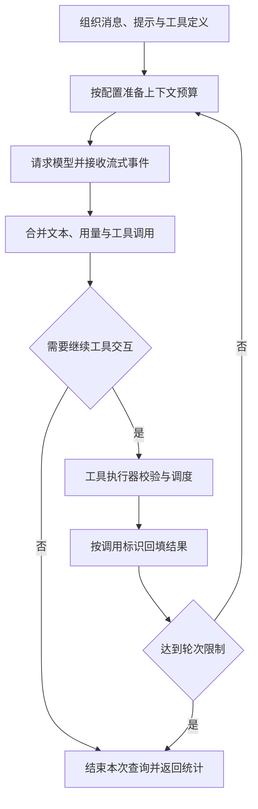

# 第5章 核心功能实现

本章结合主要模块说明代码修复流程的实现。系统在已有 Python 编程智能体上增加专用修复编排器，复用模型协议、工具循环、代码索引和知识管理能力，并新增工作副本管理、容器执行、固定验收及反馈重试。实现的关键是将模型提出的操作转化为受约束的文件变化，再将真实执行结果关联到具体候选，形成可检查的交付记录。

## 5.1 编程智能体核心能力复用

### 5.1.1 流式模型交互与工具调用循环

通用查询循环位于 `agent/query.py`，以异步生成器接收模型流并向上层输出事件。循环将系统提示、用户任务和已有历史组织成消息列表，为模型提供当前工具注册表生成的函数定义。每轮请求分别处理文本增量、工具调用增量、用量和错误事件，模型完成一轮输出后再决定是否执行工具。

流式工具参数可能分多段返回，因此实现先按调用序号维护状态，合并调用标识、函数名称和参数字符串，待消息结束后形成完整调用列表。工具执行结果携带原调用标识，写回对应的工具消息，使模型能够区分同一轮多个操作的结果。存在工具调用或模型返回工具交互停止原因时，循环继续处理，否则结束本次查询。执行过程如图5-1所示。



图5-1 复用的模型与工具交互循环

工具由 `Tool`、`ToolContext` 和 `ToolResult` 表示，分别封装操作定义、执行上下文与结果。执行器检查工具是否存在、输入是否为对象以及必要字段是否齐全，再调用处理函数。处理函数中的路径检查和业务校验继续约束实际行为。当前通用参数校验不实现完整 JSON Schema 验证，不能仅凭向模型提供参数描述就认为任意输入都已合法。

对于连续出现且声明只读、并发安全的工具，执行器使用受信号量限制的并发读取；遇到写入或其他非并发安全调用时，先等待前面的读取完成，再顺序执行该操作。这一机制保留了“读取、编辑、再读取”的必要顺序。工具异常被转换为带错误标志的结果返回模型，供其继续诊断；角色调用收到模型错误事件时则向修复编排层传播异常。

### 5.1.2 修复角色的工具注册

`VerifiedRepair._registry` 从已有工具中选择读取、目录遍历、文本搜索、符号检索和上下文获取能力。修复角色额外取得 `write_file`、`edit_file` 以及两个命令入口；协调和验证角色不注册这些写入与执行入口。每个文件工具外层增加文件树检查，编辑操作还通过 `PathGuard` 验证目标路径，并拒绝受保护文件。

命令工具保留原来的名称与参数定义，替换其处理函数，将 `command` 交给 `DockerSandbox.execute`。这样，模型仍通过统一工具协议操作仓库，但命令不会落到原通用工具的宿主 shell。命令结果序列化为 JSON 工具内容，包含退出码、输出和超时信息，失败时设置工具错误标志。

修复流程使用配置副本启用路径保护、关闭该流程的 MCP 能力，并采用不重复询问的审批设置。该设置针对已收窄的工具集合和临时副本生效，依靠路径检查、候选检查及容器约束控制执行范围。原通用会话的配置和权限模式不随之改变。

### 5.1.3 代码检索与预算化上下文

启用代码索引时，每次角色调用前针对当前副本重建索引，使检索内容能够反映已有修改。索引保存 Python 符号、文件位置、签名和近似静态调用关系，按词面相关性返回定位结果。角色可以先通过索引缩小范围，再读取实现文件确认原因。

`ContextBuilder` 按顺序装入匹配符号签名、直接调用关系签名、排名靠前符号的源码片段及涉及文件的摘要。每个条目都计入估算预算，不能容纳时跳过或停止当前部分，并记录截断标志。默认最多选择 8 个主要符号，在排名前 3 个符号中为可展示源码的符号各提供最多 40 行片段；这些上限控制检索输入，不代表完整函数一定被包含。

返回对象还记录符号、源码片段及路径和行号范围，便于区分“定位到符号”与“已经提供实现正文”。该模块使用字符启发式估算管理上下文，模型返回的实际 usage 则用于运行统计和调用预算，两者分别处理。修复验收始终依赖执行结果，检索覆盖度不直接决定成功状态。

## 5.2 工作副本与候选补丁实现

### 5.2.1 有界快照和来源指纹

`RepairWorkspace` 以源目录的当前文件内容建立初始映射，而不是仅记录 Git 提交号。`inventory` 遍历支持范围内的普通文件，排除版本控制、虚拟环境、依赖与缓存目录，以及 `.env` 前缀和部分密钥文件后缀。遍历期间拒绝符号链接和特殊文件，并限制单文件大小、总体积和文件数量，主要参数见表5-1。

表5-1 工作区快照与检查限制

| 检查项 | 当前实现 | 目的 |
| --- | --- | --- |
| 单文件大小 | 不超过 2,000,000 字节 | 限制单次读取规模 |
| 总文件体积 | 不超过 100,000,000 字节 | 控制内存快照规模 |
| 快照文件数 | 不超过 10,000 个 | 限制候选处理范围 |
| 工作副本安全扫描 | 最多检查 20,000 个目录或文件项 | 避免模型命令产生失控文件树 |
| 文件类型与名称 | 拒绝链接、特殊文件及不支持的路径字符 | 降低路径跟随和补丁解析歧义 |
| 固定文件 | 测试目录、常见测试文件与指定配置 | 保持支持范围内的验收条件 |

来源指纹由排序后的相对路径和各文件内容摘要共同生成。设初始文件集合为 \(F_0\)，其指纹计算可写为：

$$
H_0 = \operatorname{SHA256}\left(
\mathop{\Vert}_{p\in\operatorname{sort}(\operatorname{keys}(F_0))}
\left[\operatorname{UTF8}(p)\Vert 0x00\Vert\operatorname{SHA256}_{raw}(F_0[p])\right]
\right).
$$

其中，\(\Vert\) 表示字节拼接，内部摘要使用原始摘要字节。报告同时保存逐文件 SHA256 和整体指纹，用于确定候选参照及筛选经验。指纹不包含被排除文件和完整环境信息，其作用是标识本次受支持的源码快照。

初始映射保存在内存中，临时根目录下建立 `work` 和 `verify`。`work` 从初始映射创建，后续重试继续保留其编辑状态；`verify` 在基线与每个有效候选检查时重新构造，避免前一次验收副本中的辅助状态影响下一次验证。

### 5.2.2 候选检查与差异生成

修复角色结束后，编排器调用 `candidate`，重新读取工作副本并与初始映射比较。变更集合包含新增、修改和删除路径；对于只改动权限而未改变受支持文件内容的操作，该文件内容差异机制不将其作为代码补丁。核心步骤如算法5-1所示。

算法5-1 候选检查与验收副本构造

```text
输入：初始文件映射 F0，工作副本 work，验收目录 verify
1. 检查 work 中的链接、特殊文件和文件树规模
2. F ← 对 work 执行有界文件快照
3. Δ ← 按路径排序的 F0 与 F 的不同文件集合
4. 若 Δ 包含受保护路径，则拒绝候选并返回原因
5. patch ← 空字符串
6. 对 Δ 中每个路径 p：
     读取旧、新内容；缺失的一侧按空内容生成差异
     若包含零字节或无法按 UTF-8 解码，则拒绝候选
     生成 Git 风格文件头和统一差异
     对新增、删除和末尾无换行情况补充对应标记
7. 删除旧 verify，并按 F 写入新的验收副本
8. 返回 patch、F 和 Δ
```

差异生成使用 `difflib.unified_diff`，补充 `diff --git`、新增或删除文件标记以及末尾无换行标记，形成可审查的文本补丁。受保护路径检查覆盖 `tests`、`test` 目录、常见测试文件名及若干测试和构建配置。宿主编辑工具会先拒绝直接修改这些文件；即使容器命令绕过编辑工具改动了测试，候选导出时仍会因比较结果不合法而拒绝。

这两处检查分别约束编辑入口和交接结果。候选被拒绝后，系统向修复角色说明原因，但不自动恢复其工作副本，下一次尝试需要纠正相关修改。只有候选检查通过，才会重建验收副本并进入后续处理。补丁是交付表示，固定验收直接检查重建后的候选文件，不需要修改原仓库或逐轮执行 Git 补丁应用。

## 5.3 容器命令执行与资源回收

### 5.3.1 容器参数与挂载方式

`DockerSandbox` 使用异步子进程启动 Docker，为每条命令分配唯一容器名称。启动参数作为独立参数列表交给宿主进程，待执行命令仅作为容器内 `/bin/sh -c` 的参数。镜像需要预先存在，执行期间不自动拉取镜像。核心约束见表5-2。

表5-2 容器执行参数

| 参数或机制 | 当前设置 | 作用 |
| --- | --- | --- |
| 镜像与生命周期 | `--pull=never`、`--rm`、独立容器名称 | 使用预备环境，便于回收 |
| 网络与根文件系统 | `--network=none`、`--read-only` | 关闭网络并限制系统目录写入 |
| 进程权限 | `--cap-drop=ALL`、`no-new-privileges` | 收窄容器权限 |
| 资源 | `--cpus=1`、`--memory=512m`、`--pids-limit=128` | 限制单命令资源占用 |
| 执行用户 | 使用宿主进程 UID 与 GID | 避免额外提权运行方式 |
| 临时空间 | `/tmp` 挂载约 64 MiB 的 tmpfs | 为临时文件提供受限空间 |
| 工作目录 | 仅将指定副本挂载到 `/workspace` | 确定命令可见源码范围 |
| 环境与日志 | 显式设置必要变量，关闭 Docker 日志驱动 | 减少宿主信息透传和额外日志积累 |

执行用户跟随宿主进程身份，因此以普通用户启动时容器也使用对应身份，不能据此保证任意部署环境下均为非 root。文件工具、模型请求和报告保存仍由宿主应用完成，容器参数只约束转交给它的命令执行。

修复辅助命令以可写方式挂载 `work`，验收命令以只读方式挂载 `verify`。环境中明确设置工作区 Python 路径、禁止写入 Python 字节码，并关闭 pytest 第三方插件自动加载，减少只读验收目录受到缓存和宿主插件的影响。依赖需要已包含在镜像中；临时容器中产生的系统级变更不会延续到下一条命令。

### 5.3.2 输出收集、超时与取消

执行器分别启动标准输出和标准错误读取任务，持续排空管道，每个通道最多保留 20,000 字节，超过部分添加截断说明。持续读取可以避免子进程因输出管道写满而阻塞，有界保留则限制报告和反馈规模。截断后的输出按 UTF-8 容错解码，供模型和调用者检查。

命令等待使用单命令时限。达到时限后设置超时标志，并在结果中使用约定退出码；执行结束处理统一通过名称强制删除容器，以回收可能残留的后台进程。清理任务使用异步屏蔽保护，收到协程取消时仍等待清理，再传播取消；必要时终止本地 Docker 客户端，并等待输出读取任务结束。容器删除本身也设置等待时限。

每条命令最终形成 `ExecutionResult`。退出码为零且未超时才满足 `passed`；非零结果进一步按超时、部分环境相关退出码及运行器缺失信息分类。该分类是面向当前运行环境的诊断规则，不是对所有退出原因的精确推断。镜像或 Docker 不可用时，错误被保留在执行结果或上层异常报告中，执行器不回退到宿主 shell。

## 5.4 固定验收与多角色反馈重试

### 5.4.1 基线检查与角色调用

`VerifiedRepair.run` 首先检查任务、验收命令、策略和预算，并拒绝位于源工作区内的交付位置。随后建立副本，在初始 `verify` 中顺序执行固定命令。若全部通过，记录 `baseline_passed` 并结束；若出现环境或命令超时问题，记录 `environment_error`；其余测试失败作为初始修复反馈。

角色调用由 `_agent` 统一组织。它针对当前副本准备工具注册表、项目提示和技能缓冲区，以空历史调用查询循环。修复角色最多进行 8 轮模型与工具交互，其他角色最多进行 3 轮。这里的轮次约束单次角色调用；候选尝试次数和所有角色共享的模型预算由外层另行控制。

多角色策略先执行协调角色，将其计划加入任务上下文。每次尝试调用修复角色后，程序从实际文件生成候选，并将差异摘要、变更路径和后续测试结果关联到同一尝试记录。验证角色读取候选验收副本，接收的差异最多为前 24,000 个字符，需要时仍可通过只读工具检查相关文件。

### 5.4.2 验收判据与重试算法

设固定命令集合为 \(C=\{c_1,\ldots,c_m\}\)，第 \(i\) 次候选的命令结果为 \(r_{ij}\)，则本轮测试通过条件为：

$$
T_i=\bigwedge_{j=1}^{m}
\left[(r_{ij}.exit\_code=0)\land\neg r_{ij}.timed\_out\right].
$$

该条件只表达指定命令的检查结果。多角色策略还需要完成验证角色调用，之后才会设置运行成功状态。评审文字用于解释问题和形成反馈，不作为替代 \(T_i\) 的判断条件。候选循环如算法5-2所示，预算、总超时和取消由外层异常处理统一结束。

算法5-2 固定验收驱动的候选重试

```text
输入：任务上下文 context，基线结果 baseline，策略 s，最大尝试次数 A
feedback ← baseline；previous_hash ← 空
对 i = 1 到 A：
  建立第 i 次尝试记录
  调用修复角色(context, feedback)，保留工作副本修改
  尝试生成候选；若候选不合法：
    记录 invalid_patch，feedback ← 拒绝原因，继续下一次尝试
  h ← SHA256(补丁文本)，保存本轮补丁和变更文件
  若没有变更或 h = previous_hash：以 no_progress 结束
  previous_hash ← h
  results ← 在候选验收副本中执行全部固定命令
  passed ← results 全部通过；记录 results 与 passed
  review ← 空文本
  若 s 不是 single：
    evidence ← results（verified）或隐藏说明（team）
    review ← 调用验证角色(context, 候选差异, evidence)
  记录本轮评审和验证事件
  若 passed：
    设置 verified，导出 candidate.patch，按配置保存经验，结束
  若 results 包含环境错误或命令超时：以 environment_error 结束
  feedback ← review（team）或 results 与 review（其他策略）
若正常用完 A 次尝试：以 attempts_exhausted 结束
```

反馈机制保留实际失败与文字建议的区别。验证反馈策略将本轮命令结果和评审意见一起传入下一轮，修复角色据此调整实现；评审反馈策略则在后续尝试中主要传递评审文字，用于比较反馈组成的影响。初始基线和最终固定验收在三种策略中都保留。

无进展检查比较空变更及连续有效候选的补丁摘要，能够阻止直接重复提交，但不检测所有较长周期的往返修改；后者最终仍由尝试次数和共享预算限制。若测试已经通过，而验证角色在随后调用时耗尽预算，流程保留测试结果并以预算失败结束，不导出成功候选。保留这一顺序有助于区分候选代码满足测试与整个策略已经完成。

### 5.4.3 共享预算与异常结束

`BudgetClient` 包装原模型客户端，在每次请求前检查累计调用次数与累计 token，并在用量事件到达时更新统计。所有角色共用同一包装器，重试不会重置消耗。达到阈值后抛出 `BudgetExhausted`，上层转换为 `budget_exhausted`。默认参数见表5-3，实验采用的独立配置在第六章说明。

表5-3 修复流程默认预算

| 配置项 | 默认值 | 检查范围 |
| --- | --- | --- |
| 最大尝试次数 | 3 | 外层候选循环 |
| 最大模型调用次数 | 36 | 所有角色累计请求 |
| token 检查阈值 | 60,000 | 下一次模型请求前检查 |
| 总执行时限 | 900 秒 | 修复主体执行区间 |
| 单命令时限 | 60 秒 | 一次容器命令 |

token 用量来自模型返回，当前机制不在生成过程中截断响应，因此最终总量可能超过阈值。总执行时限通过 `asyncio.timeout` 包裹修复主体，触发时记录 `timeout`；异步取消记录 `canceled`，完成结束处理后继续传播。其他异常保存为 `error`。统一的 `finally` 清理临时副本、汇总调用与用量，并写入运行报告，防止失败过程只留下无法定位的完成性文字。

## 5.5 Skill 与项目 Memory 接入

### 5.5.1 角色技能加载与版本记录

Skill 注册表从内置、用户和项目位置发现 `SKILL.md`，解析名称、说明、版本及标签，并遵循禁用状态。修复流程按角色名称预选技能，不向修复角色开放通用技能写入工具。协调角色加载复现技能，修复角色加载复现与最小修改技能，验证角色加载验收检查技能。技能说明需要完成的工作及其结束条件，实际工具权限和验收仍由程序负责。

每次角色调用新建 `SkillContextBuffer`，按技能名称保存正文。重复名称替换缓冲项，消费后清空，防止同一缓冲内容在当前调用中被反复追加。正文进入消息历史后仍可能出现在后续模型请求中，“消费一次”不表示之后不再占用上下文。报告记录名称、版本、角色和正文 SHA256，区分同名技能的内容变化。

通用查询循环还保留技能候选提示与动态加载后的注入处理，但修复角色可用的工具列表不包含 `load_skill`，其流程技能由编排器明确选择。技能缺失或禁用时不会伪造已加载记录，程序继续按照实际取得的技能构建上下文。

### 5.5.2 经验筛选、失效与成功写入

Memory 使用已有 SQLite 管理器，按原始项目路径限定作用域。相关性排序综合词面匹配、重要性、置信度、新近程度和访问记录，并过滤过期数据。修复入口调用一次召回后，对 `kind=repair` 的记录解析正文，只有 `base_hash` 与当前初始指纹相同才保留；无法解析或不匹配的记录跳过。筛选后的文本最多提供 6,000 个字符，并记录召回条目标识。

随后编排器关闭配置副本的自动记忆功能，直接把已选经验作为非可信数据加入任务上下文。这样可以避免查询循环针对临时副本再次召回，也使本次使用了哪些经验能够从报告中检查。其他类型的项目记忆继续按通用召回条件处理，不声称所有经验都经过修复指纹约束。

成功保存的修复经验包含任务摘要、初始指纹、变更文件、验收命令、补丁摘要及报告路径，类型为 `repair`，来源为 `verified-repair`，有效期为 30 天。当前设置的置信度为 0.7，用于排序元数据，不代表经过校准的正确概率。记录明确说明候选只通过本次固定验收，尚未应用到原仓库，复用时仍需重新检查。

仅在运行成功且记忆启用时执行保存。召回或保存发生可处理的数据库、文件或数据错误时，将警告加入报告；保存失败不覆盖已有测试结果。关闭记忆时跳过该流程的召回与自动保存。上述机制实现经验来源与适用范围管理，其是否独立提高修复效果仍需另外的对照实验。

## 5.6 公开入口集成与运行证据保存

### 5.6.1 配置覆盖与结果适配

CLI 的 `repair` 命令先加载项目配置，复制修复选项，再覆盖用户显式提供的命令行参数。可选参数使用空值区分“未提供”与“主动设置”，避免默认次数或时限覆盖配置中的预算。命令检查验收入口和模型配置后调用修复编排器，按选择输出进度或最终 JSON；只有 `verified` 对应成功退出状态。

SDK 的 `QueryEngine.repair` 返回异步事件，同步与异步完成方法消费事件后返回报告字典。报告失败状态仍需由 SDK 调用者检查，不能因方法正常返回就认定代码修复成功。REPL 复用这一执行路径并渲染进度，修复角色历史与普通主会话历史分开管理。

Runtime 在模式分发中接入 `repair`，使用服务配置中的验收命令。适配器检查完成事件中的报告，非 `verified` 时生成错误事件，防止上层把流程结束统一登记为成功。后台任务继续使用原有项目作用域、领取和租约机制；取消后的迟到结果由任务层保护，修复运行标识与队列任务标识分别保存。

### 5.6.2 报告、补丁与事件关联

每次运行使用 UUID 创建独立交付目录。报告以 JSON 保存，事件文件按行追加带事件类型和相对耗时的记录，候选补丁按轮次单独保存。核心证据关联见表5-4。

表5-4 运行证据关联

| 内容 | 主要记录 | 检查用途 |
| --- | --- | --- |
| 输入与来源 | 任务、源目录、模型、策略、选项、初始指纹 | 确认本次处理条件 |
| 基线 | 固定命令及执行结果 | 确认修改前的失败依据 |
| 候选尝试 | 轮次、变更文件、补丁摘要、验证结果、评审或拒绝原因 | 关联修改与对应检查 |
| 知识使用 | 技能版本与摘要、召回及保存的记忆标识 | 检查过程知识来源 |
| 终止与消耗 | 状态、原因、耗时、模型调用和 usage | 分析结束条件与资源开销 |

`attempt-N.patch` 在候选合法性检查通过后保存，即使该轮未通过测试仍可供分析；`candidate.patch` 只在流程成功时导出。报告中某些尝试可能因中途异常缺少后续字段，读取时需要按实际存在的信息解释。事件记录保存角色开始、结束及工具活动，不保存全部原始模型消息，因此支持执行分析与交付核对，不提供完整模型交互重放。

输入检查失败可能发生在交付目录建立前，异常也可能在进程被强制结束时阻止完整落盘。当前实现不将文件记录描述为具备数据库事务或崩溃恢复能力。正常结束及已处理异常的报告，与独立补丁共同构成可审查结果，为下一章的功能测试和实验统计提供依据。

## 5.7 本章小结

本章说明了系统从模型工具循环到候选交付的关键实现。受限工具注册保留编程智能体的定位与编辑能力，文件快照和候选检查确定修改边界，独立容器执行提供固定验收证据，多角色流程在共享预算下使用反馈进行有限重试。Skill 和 Memory 分别提供角色步骤与带来源的项目经验，接口适配和证据文件将这些过程连接到实际调用场景。

这些实现使系统能够区分模型陈述、实际修改、测试结果和流程终止原因。下一章将依据已有验证记录和真实修复运行，分析功能覆盖、策略结果、资源消耗及当前结论的适用范围。
