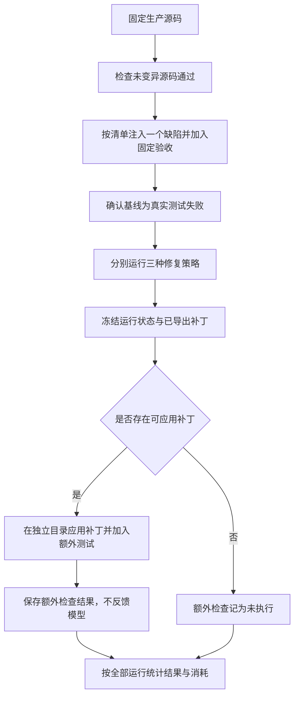
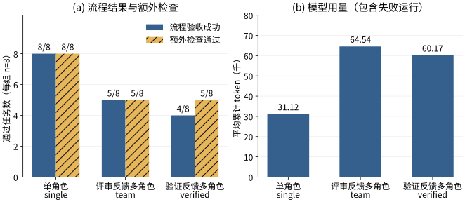

# 第6章 测试与实验分析

本章依据已归档的自动化验证与真实模型运行记录，分析系统的功能行为、修复结果和资源消耗。验证分为两个层次：功能测试使用可控输入检查执行边界、状态和交付是否符合设计；修复实验在固定源码缺陷上调用真实模型，比较不同角色与反馈策略。两类证据分别回答流程能否按规则运行和在给定任务、预算下取得何种结果，不能混用样本数量或评价指标。

## 6.1 验证目标与运行条件

### 6.1.1 验证目标与证据来源

功能验证对应第三章的验收条件，重点检查固定验收是否有效、原工作区是否受到保护，以及失败、超时、取消和预算耗尽能否正确结束。修复实验关注三个问题：不同策略的流程完成情况如何，额外检查与流程状态是否一致，多角色引入了多少模型交互开销。

本章使用 2026 年 10 月 20 日归档记录。实现对应 `main` 分支基线 `b90335dbe1e739b2092c846aec59983bfa15ce04` 上的未提交工作区，相关文件的 SHA256 另行归档。该提交号用于定位代码基础，不能代替新增实现指纹。功能验证来自自动化检查记录，修复统计来自 8 个保留任务的逐次报告、补丁和事件文件。本章整理期间没有重新调用模型或改变任务预算。

### 6.1.2 修复实验设置

三种策略使用相同模型、镜像、验收命令和外层预算，主要设置见表6-1。这里的模型调用次数和总时限是实验配置，分别为 18 次和 180 秒，与第五章列出的产品默认值区分。

表6-1 修复实验主要设置

| 项目 | 设置 |
| --- | --- |
| 源码版本 | python-dotenv v1.1.1，固定生产源码快照 |
| 源码提交 | `16e660d384b942b11879b44500afbbe021650448` |
| 执行环境 | 预先准备的 `python:3.11-slim` 镜像，使用归档镜像 ID 定位 |
| 模型 | `deepseek-v4-flash`，三种策略一致 |
| 生成设置 | 温度为 0，评估器将单次输出预算封顶为 2,048 token |
| 固定验收命令 | `python -m unittest discover -s tests -v` |
| 每次运行预算 | 最多 3 次候选尝试、18 次模型调用、60,000 token 检查阈值 |
| 时限 | 修复主体 180 秒，单条命令 60 秒 |
| 知识功能 | Skill 开启，跨任务 Memory 关闭 |
| 正式评测规模 | 8 个保留任务 × 3 种策略，每个条件运行一次，共 24 次 |

镜像归档 ID 为 `sha256:e88e9763f943ec1834f992a4b51e0f24500486803e8bc534e5767af9ea65f6ce`。容器执行采用前述资源和挂载约束。token 阈值在下一次模型请求前检查，最后一次响应可以使累计值超过阈值，因此表中的 60,000 不能解释为最终统计绝不超过的硬上限。

各次模型调用使用独立客户端和任务副本，跨任务记忆关闭，以减少前一运行保存的经验对后续条件的影响。模型服务和宿主硬件等运行条件仍可能影响耗时，归档期间还存在同机回归测试负载，因此本章把耗时作为描述性记录，不据此作严格性能结论。

## 6.2 功能测试与公开入口验证

### 6.2.1 自动化检查结果

归档的全量测试命令启用真实 Docker 测试，结果为 160 项通过。实现前已有 134 项测试，本轮增加 25 项修复相关测试和 1 项快照回归测试，不能将全部 160 项都归为新增功能测试。主要工程检查见表6-2。

表6-2 归档工程验证结果

| 检查 | 归档结果 | 说明 |
| --- | --- | --- |
| `YECODING_TEST_DOCKER=1 uv run --extra dev python -m pytest` | 160 passed，28.38 秒 | 包含既有回归与 Docker 测试 |
| `uv run --extra dev ruff check .` | 全部通过 | 静态规则检查 |
| `uv run --extra dev ruff format --check .` | 101 个文件已符合格式 | 归档时的代码格式检查 |
| `git diff --check` | 通过 | 检查已跟踪改动的空白问题 |
| `uv build` | 源码包与 wheel 构建完成 | 打包检查 |
| CLI 帮助、版本和环境诊断 | 通过，版本为 0.1.0 | 验证命令入口与环境可用性 |

功能测试中的模型客户端采用脚本化协议夹具，以可重复方式生成预定编辑、过度肯定的评审或错误候选；测试命令仍在真实容器中执行。这使得测试可以稳定覆盖特定分支，而不把模型是否恰好生成某种行为作为前提。真实模型能力则由后续修复实验单独评价。

### 6.2.2 代表性验收场景

表6-3按现有测试断言归纳代表性覆盖，场景编号沿用第三章。表中结果属于上述回归记录，不构成另一批新增实验样本。

表6-3 代表性功能测试覆盖

| 场景 | 检查内容 | 观察与断言 |
| --- | --- | --- |
| AC-01、AC-02 | 验收入口缺失、初始基线已通过 | 缺少命令被拒绝；基线通过时不调用模型、不宣称完成修复 |
| AC-03 | 先提交失败候选，再根据流程进入下一轮 | 两次尝试分别失败、通过，导出补丁并保持源目录内容不变 |
| AC-04 | 评审持续声称通过，但实际测试失败 | 最终记录次数耗尽，不生成成功候选补丁 |
| AC-05 | 文件越界、直接修改测试、命令修改测试 | 工具边界拒绝或候选检查拒绝，不按篡改后的测试验收 |
| AC-06 | 调用预算耗尽、没有补丁变化 | 记录预算失败或无进展，并保留报告 |
| AC-07 | 镜像缺失、命令超时、协程取消、总超时 | 返回对应失败，检查容器或副本清理，不回退宿主执行 |
| AC-08 | 技能来源、经验写入、过期源码指纹及关闭记忆 | 报告保留技能记录，成功经验写入，失配经验不注入，关闭时不自动保存 |
| AC-09 | CLI 配置、SDK 复用、Runtime 失败适配 | 显式参数覆盖正确，SDK 使用同一流程，失败报告转为 Runtime 错误事件 |

沙箱测试还检查了宿主环境中的哨兵变量未透传、容器内未挂载 Docker socket、工作区以外写入失败、网络连接受限，以及只读验收挂载无法写入。大输出测试确认管道可以持续排空且保留量有界；超时和取消测试根据容器名称查询，确认对应容器已被清理。这些断言覆盖已实现的执行约束，不替代针对容器逃逸的安全审计。

真实 CLI 演示另使用开发任务 `default-value` 调用模型，固定验收通过并以退出码 0 结束，报告记录三个角色的技能和补丁。该演示证明命令参数、真实模型和修复流程已经接通，但不计入 24 次保留任务运行。REPL、SDK 和 Runtime 的集成检查也不等同于每个入口都完成了一组独立的真实模型对比。

## 6.3 修复任务构造与独立检查

### 6.3.1 源码来源和任务划分

实验从固定版本的 python-dotenv 提取生产源码，包含 8 个 Python 文件，不直接使用上游测试作为评测套件。在此基础上，每个任务单独注入一处行为变异，并编写统一验收测试。任务清单记录原字符串、替换字符串、文件和问题描述，变异要求在对应源码中恰好匹配一次。

任务划分为 2 个开发任务和 8 个保留任务，见表6-4。它们是基于外部项目源码构造的人工缺陷，不是上游历史 issue，也不是 SWE-bench 样本。任务描述通常明确指出期望行为，部分还包含接口线索，因此其难度主要体现在局部实现定位与修复。

表6-4 人工缺陷任务清单

| 任务标识 | 划分 | 生产文件 | 注入后主要行为 |
| --- | --- | --- | --- |
| `default-value` | 开发 | `variables.py` | 缺失变量不再使用配置默认值 |
| `literal-value` | 开发 | `variables.py` | 字面量解析后丢失原文本 |
| `none-value` | 保留 | `variables.py` | 显式空值被转换为字符串 `None` |
| `trailing-literal` | 保留 | `variables.py` | 尾部字面量和纯文本被丢弃 |
| `variable-cursor` | 保留 | `variables.py` | 占位符迭代边界错误，残留原文本 |
| `unquoted-whitespace` | 保留 | `parser.py` | 未正确去除未加引号值的尾部空白 |
| `escape-decoding` | 保留 | `parser.py` | 引号内支持的转义序列未解码 |
| `line-tracking` | 保留 | `parser.py` | 原始行号不随读取内容更新 |
| `override-environment` | 保留 | `main.py` | 覆盖开关为真时仍不替换已有变量 |
| `disable-interpolation` | 保留 | `main.py` | 禁用插值选项未生效 |

运行前先检查未变异源码通过验收，再逐个检查变异源码产生真实测试失败。归档记录中，10 个变异任务的基线均为退出码 1、分类为 `test_failure`，未变异源码的固定验收和额外检查均通过。这一步排除了将无法启动的执行环境误当作可修复缺陷的情况，但任务集仍只代表这些特定行为变异。

### 6.3.2 固定验收与额外检查隔离

固定验收包含 9 个测试方法，覆盖默认值、字面量、空值、插值边界、空白、转义、行号、环境覆盖和插值开关。每次修复都使用完整的固定套件，测试文件置于任务副本中，模型可读取但不能交付其修改。额外检查增加 4 个测试方法，包括空字符串、中文文本、相邻与未闭合占位符、更多换行和环境变量边界；加入后共执行 13 个方法。

额外测试文件只在某个策略运行结束后写入独立检查目录。评估器把导出的成功补丁，或失败运行中已保存的最后一轮补丁，应用到原变异源码副本，再执行包含额外检查的套件。额外文件与结果不反馈给模型，也不用于后续重试。过程如图6-1所示。



图6-1 修复实验与额外检查过程

没有补丁时，额外检查记录为空，不能写成该补丁在额外测试中失败。额外检查也由本项目编写，独立性主要体现在模型可见范围和执行阶段上，不代表独立研究者标注或完整覆盖。通过检查说明候选满足已检查行为，不证明恢复了上游所有语义。

## 6.4 对比策略与评价指标

### 6.4.1 受控策略设置

三种策略均在新增修复编排器内执行，使用同样的候选检查和固定验收。差异见表6-5。`team` 表示本实验中的评审反馈条件，与系统原有通用 Team 模式分别定义。

表6-5 三种修复策略

| 策略 | 参与角色 | 验证角色接收的本轮测试证据 | 测试失败后的主要反馈 |
| --- | --- | --- | --- |
| `single` | 修复 | 无验证角色 | 原始执行结果 |
| `team` | 协调、修复、验证 | 不直接提供新测试结果 | 评审文字 |
| `verified` | 协调、修复、验证 | 提供执行结果 | 执行结果与评审文字 |

初始基线结果在三组中均用于启动修复。三组都使用实际固定命令作为最终验收依据，因而这里比较的是角色与反馈组织，不能把 `team` 描述为完全没有执行检查。策略按任务清单顺序依次运行，未随机打乱条件顺序；相同预算设置也不意味着模型会实际消耗相同资源。

### 6.4.2 指标定义与统计口径

设每组任务数为 \(N=8\)，运行 \(i\) 的终止状态为 \(s_i\)，额外检查通过标志为 \(e_i\)。流程验收成功率和额外检查通过率定义为：

$$
R_{workflow}=\frac{1}{N}\sum_{i=1}^{N}\mathbf{1}[s_i=\mathrm{verified}],
\qquad
R_{extra}=\frac{1}{N}\sum_{i=1}^{N}\mathbf{1}[e_i=\mathrm{passed}].
$$

未执行额外检查的运行不计入通过数，但仍保留在全部任务分母中，并单独解释。错误验收数统计流程已经标记成功、额外检查却未通过的运行。它用于核对交付结论与额外检查的一致性，不把无补丁的预算失败计作错误验收。

资源指标包括模型累计 token、模型调用次数和修复报告中的主体耗时。平均值以每组全部 8 次运行计算，包含失败，不只统计成功样本。token 使用供应商返回的输入与输出用量汇总，包含各角色反复携带上下文产生的累计输入，不是唯一源码长度，也未换算成费用。报告耗时不包含评估器随后执行的额外检查，不能视为整个评估脚本的端到端耗时。

每个任务、每种条件只有一次运行，本章报告描述性结果，不给出重复试验方差、显著性判断或 pass@k 估计。温度为 0 有助于约束生成设置，但不能保证远程模型服务在所有时间完全可重复。

## 6.5 修复结果与资源消耗

### 6.5.1 汇总结果

三组正式评测结果见表6-6。单角色完成 8 个任务，评审反馈多角色完成 5 个，验证反馈多角色完成 4 个；流程成功率依次为 100.0%、62.5% 和 50.0%。在这批任务及统一预算下，新增角色没有形成完成率优势。

表6-6 保留任务汇总结果

| 策略 | 流程验收成功 | 额外检查通过 | 预算耗尽 | 错误验收数 |
| --- | --- | --- | --- | --- |
| `single` | 8/8（100.0%） | 8/8（100.0%） | 0/8 | 0 |
| `team` | 5/8（62.5%） | 5/8（62.5%） | 3/8 | 0 |
| `verified` | 4/8（50.0%） | 5/8（62.5%） | 4/8 | 0 |

共有 18 次运行取得可应用补丁并执行额外检查，这 18 次均通过；其余 6 次预算失败没有导出补丁，额外检查未执行。验证反馈组多出的一次额外通过来自预算失败运行，说明候选行为通过检查与流程按预算完成是两个不同指标。该运行仍按原状态计为失败。

三组均未观察到错误验收，但它们共用固定测试关口，且额外检查与任务均为有限覆盖，不能将零错误验收归因于增加了验证角色。现有样本也没有出现固定验收通过、额外检查失败的候选，因此不足以比较各策略识别此类候选的能力。

### 6.5.2 模型用量与耗时

模型消耗见表6-7，其中平均 token 四舍五入为整数，调用均值保留三位小数。多角色组的平均累计用量分别约为单角色的 2.07 倍和 1.93 倍，平均调用次数也更高。这反映了在当前实现中组织多个独立上下文、读取源码和完成复查的实际成本。

表6-7 全部运行的平均资源消耗

| 策略 | 平均累计 token | 平均模型调用次数 | 平均主体耗时/秒 |
| --- | --- | --- | --- |
| `single` | 31,120 | 5.750 | 13.44 |
| `team` | 64,541 | 9.125 | 17.00 |
| `verified` | 60,167 | 9.750 | 18.06 |



图6-2 三种策略的任务结果与平均模型用量，每组 8 次，包含失败运行

图6-2将流程成功、额外检查和累计用量并列展示。额外检查通过数仍以每组 8 次为参照，不将未检查样本隐藏在分母之外。平均用量高于 60,000 的情况符合请求前阈值检查机制；部分成功运行也会超过该值，因为最后一次响应完成后不再需要发起下一次请求。

耗时同时受到模型服务响应、容器启动、宿主负载和提前终止影响。某个策略因预算较早失败而耗时较短，不意味着它完成同等工作更快。考虑到本次运行期间的同机负载和单次测量，本章不据此推导稳定的延迟比例，也不据此估计生产环境吞吐量。

### 6.5.3 逐任务状态

逐任务结果见表6-8，单元格依次表示流程状态与额外检查状态。“预算”对应 `budget_exhausted`，“未检查”表示没有可供额外检查的导出补丁。

表6-8 保留任务的流程与额外检查结果

| 任务 | `single` | `team` | `verified` |
| --- | --- | --- | --- |
| `none-value` | 成功/通过 | 成功/通过 | 成功/通过 |
| `trailing-literal` | 成功/通过 | 预算/未检查 | 预算/通过 |
| `variable-cursor` | 成功/通过 | 成功/通过 | 成功/通过 |
| `unquoted-whitespace` | 成功/通过 | 成功/通过 | 成功/通过 |
| `escape-decoding` | 成功/通过 | 成功/通过 | 成功/通过 |
| `line-tracking` | 成功/通过 | 成功/通过 | 预算/未检查 |
| `override-environment` | 成功/通过 | 预算/未检查 | 预算/未检查 |
| `disable-interpolation` | 成功/通过 | 预算/未检查 | 预算/未检查 |

所有 24 次运行都只建立了一轮尝试记录。成功运行在首轮候选通过后结束，失败运行在首轮过程中触及预算，未进入第二轮。因此，这批真实模型结果不能验证多轮反馈提高成功率的假设。前述脚本化模型与真实 Docker 测试证明了重试分支可以工作，但模型能否在更复杂任务中有效利用下一轮证据，仍需其他实验。

## 6.6 代表案例与失败阶段分析

### 6.6.1 有效候选的局部修复

`none-value` 将变量解析函数的返回改为 `str(result)`，导致映射中显式存在的空值变成文本 `None`。单角色运行首先得到 `test_none` 的真实失败，随后在 `dotenv/variables.py` 增加空值判断，关键差异为：

```diff
 result = env.get(self.name, default)
+if result is None:
+    return ""
 return str(result)
```

该运行修改一个生产文件，首轮固定 9 项验收通过，随后包含 4 项额外检查的完整套件也通过；模型调用 5 次，累计 21,220 token。候选并非逐字恢复上游返回语句，但满足已检查行为。这一案例说明判据是任务行为与回归检查，不能把“与参考补丁文本相同”作为唯一修复定义。

协调、评审角色在同一任务中也能形成成功结果，但该任务本身不要求跨文件方案协调。三种策略均通过，不能据此说明增加角色是完成该缺陷所必需的条件。

### 6.6.2 测试通过后的预算失败

验证反馈策略在 `trailing-literal` 上恢复 `if cursor < length`，候选固定验收已经通过。随后验证角色开始读取代码并继续请求模型时，累计 token 触及阈值，流程以 `budget_exhausted` 结束，未生成成功标志与 `candidate.patch`。归档记录为 11 次模型调用、60,863 token，仍保留 `attempt-1.patch`。

评估器在运行结束后应用该尝试补丁，额外检查通过。因此，表6-6中该组的额外通过数为 5，而流程成功数为 4。若仅依据补丁事后通过测试就把本次状态改成成功，会改变原先定义的策略完成条件，并掩盖验证角色调用成本。本章保留失败状态，同时报告候选的事后检查结果。

这一现象揭示了当前编排的取舍：把角色交接完整性也纳入成功条件，可以明确表示流程尚未完成，但在局部缺陷中会使已通过验收的候选承担进一步复查成本。它为后续研究按风险选择是否复查提供了问题依据，尚不构成该优化已有效的证据。

### 6.6.3 其余预算失败与证据边界

其余 6 次预算失败的事件均显示协调角色完成、修复角色开始，但修复角色尚未正常返回到候选生成阶段；对应尝试记录仅有轮次，没有导出的候选补丁。源于模型工具交互期间的预算终止，不应解释为已经产出 6 个被额外测试判错的修复。

7 次失败的模型调用数均未达到 18 次，但累计 token 已达到检查阈值，因而本批失败主要由 token 检查触发。角色独立历史有利于隔离职责，也会重复携带任务、源码和工具结果。当前结果支持报告这种成本，不能进一步分离出角色划分、阅读策略、反馈文字及模型行为各自的因果贡献。

## 6.7 有效性限制与讨论

### 6.7.1 样本与任务难度

保留任务只有 8 个，全部来自同一项目，变异集中于三个生产文件，修复通常为局部判断或赋值恢复。任务描述提供了明确行为线索，未覆盖跨文件设计、依赖环境准备、复杂并发或长时间诊断。单角色的 8/8 是当前小样本的观察结果，不能推广为任意代码任务的成功率，也不能由此认定所有多智能体协作均无价值。

开发与保留划分减少了把开发案例直接计入成绩的问题，但任务及测试由同一项目构造，未经过外部专家独立确认。共同固定套件还覆盖了开发任务涉及的行为，因此这是在共享验收条件下的保留缺陷评测，不是对全新仓库和未知测试分布的全面泛化验证。

### 6.7.2 统计与比较条件

每个条件只有一次运行，未随机化条件顺序，也没有控制模型服务所有后台变化。三组共用相同请求次数与 token 阈值，但多角色完成同一次任务的必要调用较多。当前结果反映这一统一预算下的整体流程取舍，不能证明在调整预算或采用按阶段分配预算后仍有相同排序。

本章未在观察到失败后提高保留任务预算并重报结果，也没有用成功子集替代全部任务均值。若后续研究更高预算、动态角色选择或并行方案，应预先冻结新设置并独立报告，避免把事后调参当作原实验结论。现有运行均未进入第二轮，也限制了对两种多角色反馈差异的评价。

### 6.7.3 功能验证与质量收益

Skill 与 Memory 有功能级测试，但本轮真实修复实验始终开启 Skill、关闭跨任务 Memory，没有独立的知识功能消融。因此，本章可以说明技能加载、来源记录、经验筛选和保存已实现，不能声称它们分别提高了修复率。AST 上下文检索的早期实验同样不直接等于本章端到端修复收益。

测试套件只能覆盖有限行为，容器功能测试也不能代替全面的安全证明。报告与事件支持检查正常执行和已处理异常，但未包含所有模型原始消息、完整硬件快照及远程服务版本状态，无法承诺逐字复现模型输出。系统当前价值主要在于把候选、执行证据、预算与终止原因关联起来，使成功和未完成都能够被解释。

## 6.8 本章小结

本章根据归档记录验证了修复流程的主要功能和公开入口，并在 8 个保留人工缺陷上完成三策略、24 次真实模型运行的分析。单角色、评审反馈多角色与验证反馈多角色的流程成功数分别为 8、5、4，额外检查通过数分别为 8、5、5；7 次失败均为 token 预算耗尽，未观察到错误验收。

结果表明，隔离执行、固定验收、状态记录和候选交付能够真实运行，同时暴露了当前多角色流程在局部任务上的预算成本。现有实验不支持多角色提高成功率，也不足以证明多轮反馈、Skill 或 Memory 的独立质量收益。下一章将据此总结已完成工作，并讨论需要进一步验证的改进方向。
