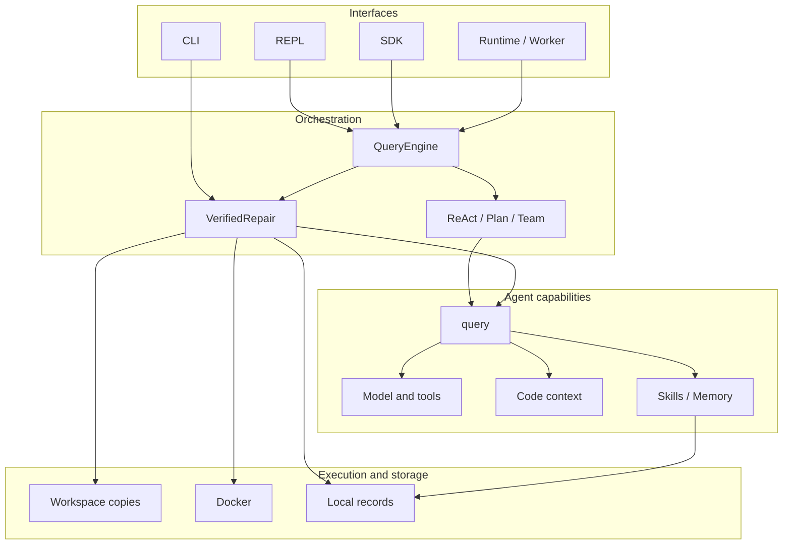

# Chapter 4 System Design

## 4.1 Architecture and design choices

Figure4-1 separates interfaces, orchestration, reusable capabilities and execution/storage. These are logical responsibilities in one application, not separate services. Interfaces collect options and display events; the orchestrator determines completion; the existing agent supplies model/tool interaction, context and knowledge.

Figure4-1 System architecture: general agent modes and dedicated repair share capabilities, while repair owns copies, command constraints and delivery.

General modes retain their original completion rules. A dedicated repair path was chosen to reuse the query loop without treating ordinary model completion as fixed acceptance. Configuration is copied before adjusting tools, paths or policies, leaving the original session unchanged.

Sequential handoffs provide clear candidate ownership through one writer. Concurrent candidates would require independent copies and merge/conflict policies, which were not implemented. CLI constructs `VerifiedRepair` directly; the read-evaluate-print loop (REPL), SDK and Runtime use `QueryEngine.repair`. These adapters share the repair core without identical invocation paths.

## 4.2 Roles and candidate handoffs

Roles are contexts, not necessarily separate models or processes. Table4-2 defines their capabilities. Only the worker writes business code; internal read-only indexing may still create technical caches. Arbitrary Model Context Protocol (MCP), web and memory-writing tools are not exposed.

Table4-2 Role capabilities, inputs and handoff artefacts.

| Role | Tools/workspace | Input | Handoff |
| --- | --- | --- | --- |
| Coordinator | Read/search in work | Task, rules, experience | Concise plan |
| Worker | Read/edit/commands in work | Task, plan, feedback | Actual edits and summary |
| Verifier | Read/search in verify | Task, patch, permitted evidence | Review and suggestions |

Each role receives a fresh history and skill buffer. Retries preserve work files while supplying the latest feedback to a new worker context. Within an attempt, worker completion precedes candidate validation and fixed tests; only then does the verifier receive the reconstructed candidate. Retries repeat the worker-to-verifier stages while budget remains. Actual timestamped instances of these handoffs are examined in Figure6-4, rather than assuming that a design sequence demonstrates executed behaviour.

The verifier interprets evidence but does not supply a machine-authoritative approval. Failing tests cannot be overridden by review. Conversely, passing tests followed by verifier budget exhaustion remain an unsuccessful workflow. Three strategies vary roles and feedback while retaining fixed acceptance; their exact comparison appears in Table6-5.

## 4.3 Files and execution

An in-memory initial snapshot records supported paths, bytes and hashes. The worker edits `work`; each legal candidate reconstructs `verify`. The source repository is read to establish the baseline, work is the only editable business-code copy, and fixed acceptance receives a read-only verification mount. Reports and patches are exported to a separate delivery directory, not applied automatically to original source. These are distinct ownership boundaries even though all copies originate from the same bytes.

Candidates identify additions, modifications and deletions and reject protected or unsupported content. Verification uses reconstructed bytes, not worker descriptions. Snapshot exclusions and limits protect the supported boundary, not a full operating-system image or universal secret detection.

Each command creates a prepared-image container. Worker commands mount work writable; acceptance mounts verify read-only. Network, capabilities and resources are restricted. Containers do not preserve process state between commands. The host still performs bounded file operations, model communication, indexing and reporting. Unavailable images never trigger host-shell fallback.

## 4.4 States and evidence

Reports use JavaScript Object Notation (JSON). They associate source/model/options, baseline, attempts, patches, tests, reviews, skills, memory identifiers and usage. Table4-4 lists run states; invalid candidates use attempt-level `invalid_patch`.

Table4-4 Run states and their meanings.

| State | Meaning |
| --- | --- |
| `running` | Processing started |
| `baseline_passed` | No failing baseline established |
| `verified` | Acceptance and required handoffs finished |
| `environment_error` | Environment failure or command timeout |
| `no_progress` | Empty or consecutive repeated candidate |
| `attempts_exhausted` | Candidate allowance consumed |
| `budget_exhausted` | Model-call or token threshold reached |
| `timeout` | Overall deadline reached |
| `canceled` | Repair coroutine cancelled |
| `error` | Other exception |

`report.json` summarises a run, `events.jsonl` records ordered activity and `attempt-N.patch` preserves legal attempts. Only success exports `candidate.patch`. Interrupted attempts may lack later fields. Records support inspection, not full raw-message replay or transactional crash recovery.

## 4.5 Knowledge and interfaces

Role-selected reproduction, minimal-change and verification skills are fingerprinted. Memory is recalled once using the original project scope; repair-kind entries must match source. Selected experience is untrusted data, while automatic recall inside temporary copies is disabled. Only successful enabled runs save experience. Warnings do not overwrite test outcomes.

Table4-5 summarises interface contracts. Explicit options override configuration; omitted CLI values do not overwrite configured budgets.

Table4-5 Entry points and result handling.

| Interface | Invocation | Result |
| --- | --- | --- |
| CLI | `yecoding repair`, repeatable `--test` | Progress/JSON; success exit only if verified |
| REPL | `/repair <task>` | Configured tests; separate history |
| SDK | `QueryEngine.repair` | Events/report; caller inspects status |
| Runtime | Turn/Task with `mode=repair` | Configured tests; unsuccessful report becomes error |

Runtime does not expose every SDK option as a Hypertext Transfer Protocol (HTTP) request field. Queue IDs manage claims, leases and cancellation; repair IDs locate evidence. Cancellation may not immediately interrupt a model request, but late completion cannot overwrite cancelled task state.
