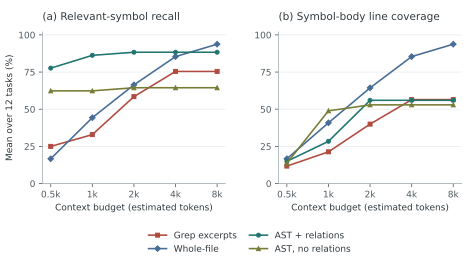
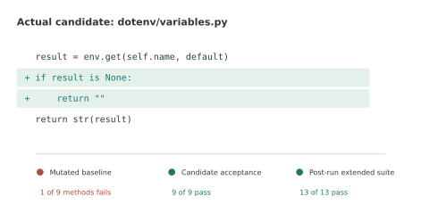

# Chapter 5 Implementation

## 5.1 Shared query loop and restricted tools

The asynchronous query generator in `agent/query.py` builds instructions, history and tool definitions, then processes text, tool fragments, usage and errors. Calls are reconstructed by index and associated with results by identifier. Tool existence, object inputs and required fields are checked; handlers enforce paths. This is not complete JSON Schema validation.

Adjacent read-only, concurrency-safe calls run under a semaphore; writes preserve ordering. Exceptions become error-marked observations. Repair registries reuse reading, traversal, search and context tools. Only the worker receives editing and command tools. Command schemas remain familiar, but their handlers invoke `DockerSandbox.execute` instead of a host shell. The copied configuration restricts MCP and paths without changing the original session.

Python indexing supplies signatures, approximate relationships and selected source. Default context assembly selects up to eight symbols and at most 40 source lines from eligible symbols among the top three. Source spans and truncation distinguish localisation from full implementation coverage; heuristic tokens are separate from provider usage.

Figure5-1 tests this packing policy in a fresh, model-free sweep on 26 October 2026: 12 source-labelled understanding tasks on the pinned python-dotenv snapshot, four retrieval strategies and five budgets, producing 240 contexts. The existing evaluation runner supplies every strategy with the same task-author keywords; AST retrieval additionally uses the task query, while the relation ablation retains the same AST query. A symbol is counted as retrieved if its first four source lines intersect a returned span. Body coverage instead measures the fraction of each labelled symbol's full line interval present, averaged within tasks and then across the 12 tasks. These metrics distinguish finding an interface from exposing its implementation.



Figure5-1 Fresh deterministic retrieval sweep over 12 tasks per point. Left: relevant-symbol recall. Right: coverage of labelled symbol bodies. Budgets use the implemented token estimator, not billed model tokens; no generated-answer or repair-quality scores are measured.

At a 4,000-token allowance, AST with relations retrieves 88.3% of labelled symbols using a mean 1,243 estimated tokens, compared with 85.4% and 3,617 for whole-file retrieval: 65.6% less assembled context, not 65.6% lower end-to-end model cost. However, AST body coverage is only 56.0%, versus 85.4% for whole-file retrieval. Removing relations lowers AST recall to 64.4%. The 2,000-to-8,000-token plateau exposes the fixed symbol/source-selection caps: extra budget alone cannot recover unselected code. Whole-file recall reaches 93.8% at 8,000. Thus structural context is useful for compact localisation, but file reads remain necessary for detailed diagnosis; this auxiliary experiment does not establish better repairs.

## 5.2 Source snapshots and candidates

`RepairWorkspace` records current supported bytes, excluding version control, dependencies, caches and standard private-file patterns. It rejects links, special files and excessive trees. Exact limits are listed in TableA-4. For initial file map $F_0$, the source fingerprint is:

$$
H_0=\operatorname{SHA256}\left(
\mathop{\Vert}_{p\in\operatorname{sort}(\operatorname{keys}(F_0))}
[\operatorname{UTF8}(p)\Vert0x00\Vert\operatorname{SHA256}_{raw}(F_0[p])]
\right).
$$

The inner digest contributes raw bytes. SHA-256 is the 256-bit Secure Hash Algorithm; paths use the 8-bit Unicode Transformation Format (UTF-8). Excluded files and environment state are outside this fingerprint. Work persists across attempts; verification is rebuilt from actual candidate bytes, following Algorithm5-1.

Algorithm5-1 Candidate validation and verification-copy construction.

```text
Input: baseline F0, edited work, verification path
1. Check file types, supported paths and tree limits.
2. F <- bounded snapshot of work.
3. Delta <- sorted content differences between F0 and F.
4. Reject protected changes or non-UTF-8/NUL content.
5. Generate a Git-style unified patch for Delta.
6. Replace verification files with F.
7. Return patch, changed paths and fingerprints.
```

Differences use `difflib.unified_diff` with creation/deletion and missing-final-newline markers. Content comparison excludes permission-only changes. Host editing rejects protected tests early, while candidate checks catch command-made changes too. Rejection does not restore work automatically: a later attempt must correct it.

Figure5-2 gives a concrete candidate from the archived `none-value` task. The two added statements preserve existing non-null conversion while correcting null expansion. This connects byte-derived patch delivery to executable evidence rather than a worker summary. The extended suite includes the fixed methods; its 13 passes are not 13 additional independent tests. Chapter6 gives the task construction and comparison conditions.



Figure5-2 Actual none-value patch excerpt with local indentation and diff addition markers, paired with its archived baseline and candidate checks. Two added statements prevent None becoming text; the post-run 13-method suite includes the nine fixed methods and four additional methods.

## 5.3 Container lifecycle

Each command uses a unique container name, a prepared image and argument-list subprocess invocation. Generated text is passed only to the container shell. Network is disabled; root is read-only; capabilities are dropped; limits are one CPU, 512 MiB memory and 128 processes. A roughly 64 MiB temporary filesystem supports writes. Full arguments appear in TableA-3.

Identity follows the host user ID (UID) and group ID (GID), not a universal non-root guarantee. Explicit environment variables disable bytecode writes and third-party pytest plugin autoload. Dependencies must already exist. Worker and acceptance mounts differ in writability.

Output pipes are continuously drained, retaining at most 20,000 bytes per channel. Timeout/cancellation triggers named-container removal and joins output tasks. Cleanup is shielded before cancellation propagates. `ExecutionResult.passed` requires exit zero without timeout; diagnostic environment classification is heuristic, and failures never fall back to host execution.

## 5.4 Fixed acceptance and budgets

Validation precedes directory creation. A passing baseline ends as `baseline_passed`; environment problems remain distinct from test failure. Worker calls allow eight model/tool rounds; other roles allow three. Candidate acceptance is:

$$
T_i=\bigwedge_{j=1}^{m}
[(r_{ij}.exit\_code=0)\land\neg r_{ij}.timed\_out].
$$

A multi-role workflow additionally requires its verifier call to complete. Algorithm5-2 defines the retry sequence.

Algorithm5-2 Fixed-acceptance retry under shared budgets.

```text
feedback <- baseline; previous_hash <- empty
For each permitted attempt:
  Call worker with task and latest feedback.
  Validate candidate; on rejection, return its reason.
  Stop if changes are empty or repeat previous_hash.
  Save attempt patch; execute all fixed commands.
  Call verifier if required, with permitted evidence.
  If tests passed, export success after handoffs.
  Stop on environment failure or exhausted budget.
  Otherwise return execution/review feedback and retry.
Stop as attempts_exhausted if the loop finishes.
```

All roles share one `BudgetClient`. Product defaults are three attempts, 36 requests, a 60,000-token pre-request threshold, 900 seconds overall and 60 seconds per command. Chapter6 reports different experimental request/time limits. The final response can cross the token threshold. Consecutive hashes detect direct repetition, not every longer edit cycle. Unified finalisation records status/usage, removes copies and writes evidence.

## 5.5 Knowledge and delivery

Each role owns a skill buffer, with name/version/body hashes recorded. Consumed text can remain in history; one-time injection does not imply no subsequent context cost. The worker cannot dynamically grant itself additional tools through skills.

Memory recall uses original project scope and filters expired entries; repair entries also require a matching `base_hash`. Selected text is limited to 6,000 characters. Successful records expire after 30 days and use confidence 0.7 as ranking metadata, not calibrated correctness probability. They state that the patch remains unapplied.

A universally unique identifier (UUID) identifies each delivery. CLI uses only explicit overrides; SDK callers inspect report status; Runtime converts unsuccessful completion to an error and preserves queue cancellation rules. Reports, attempt patches and events retain available evidence, but input rejection or forced termination may prevent complete persistence.
