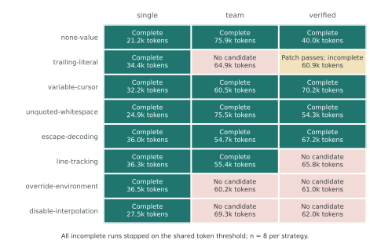
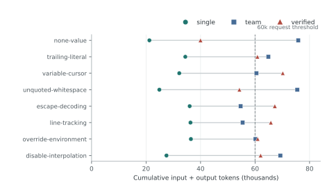
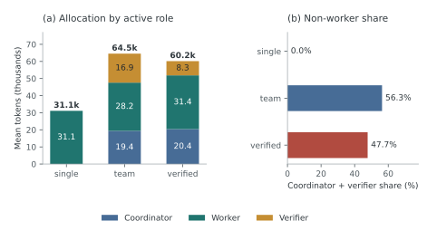
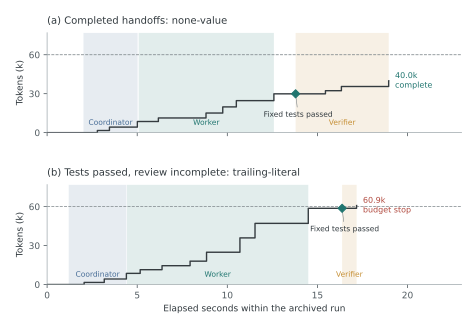

# Chapter 6 Testing and Results

## 6.1 Evidence and settings

The real-model comparison uses evidence archived on 20 October 2026. Implementation was in an uncommitted workspace based on `main`, HEAD `b90335dbe1e739b2092c846aec59983bfa15ce04`; separate file fingerprints identify evaluated changes. A 26 October supplement reruns model-free retrieval and Docker fixture checks, without changing or repeating the 24 real-model runs. Role-level costs and timelines below are newly reconstructed from their archived event logs. Functional evidence, retrieval behaviour and repair quality have different denominators.

Table6-1 fixes the repair conditions. Experimental limits differ from product defaults.

Table6-1 Configuration shared by the three repair strategies.

| Item | Setting |
| --- | --- |
| Source | python-dotenv v1.1.1 production snapshot |
| Source commit | `16e660d384b942b11879b44500afbbe021650448` |
| Environment | Prepared `python:3.11-slim` image |
| Model | `deepseek-v4-flash` |
| Generation | Temperature 0; response allowance capped at 2,048 tokens |
| Acceptance | `python -m unittest discover -s tests -v` |
| Run budget | 3 attempts; 18 calls; 60,000-token threshold |
| Deadlines | 180 s body; 60 s per command |
| Knowledge | Skills enabled; cross-task memory disabled |
| Size | 8 held-out defects, 3 strategies, one run/condition: 24 runs |

The archived image is `sha256:e88e9763f943ec1834f992a4b51e0f24500486803e8bc534e5767af9ea65f6ce`. Fresh clients and task copies prevent conversational carry-over. The final response can cross the pre-request token threshold. Remote-service variation and concurrent host regression load limit timing interpretation.

## 6.2 Functional verification

Table6-2 reports archived checks, not newly executed results. The 160 tests comprise 134 existing tests, 25 new repair tests and one snapshot regression.

Table6-2 Archived engineering checks and their scope.

| Check | Result | Scope |
| --- | --- | --- |
| Docker-enabled full pytest run | 160 passed, 28.38 s | Existing and new tests |
| Ruff check | Passed | Static rules |
| Ruff format check | 101 files formatted | Archived state |
| `git diff --check` | Passed | Tracked whitespace |
| `uv build` | Source/wheel built | Packaging |
| Help, version and doctor | Passed; 0.1.0 | Public CLI |

The full test invocation was `YECODING_TEST_DOCKER=1 uv run --extra dev python -m pytest`. Scripted model fixtures produce controlled edits and misleading reviews, while commands execute in real Docker containers. They verify branches without assuming a real model will exhibit a particular failure.

Checks cover source preservation, failed-then-passing retry, protected-test changes through tools and commands, exhausted budgets, missing images, timeout and cancellation cleanup. Sandbox assertions examine environment-variable forwarding, absence of a Docker socket, network and mount restrictions, and bounded output draining. These are functional checks, not a container-escape audit.

A real CLI demonstration on development task `default-value` exported a patch and exited successfully. It is excluded from held-out results. SDK/Runtime adaptation checks do not constitute separate real-model comparison suites for every entry point.

## 6.3 Tasks and independent checks

Eight production files were taken from pinned python-dotenv source. Each task injects one documented mutation, with an exactly-once original-text match. Table6-4 identifies the split. These are synthetic defects, not upstream historical issues or SWE-bench instances.

Table6-4 Development and held-out defects with their mutated behaviours.

| Task | Split | File | Behaviour |
| --- | --- | --- | --- |
| `default-value` | Dev | `variables.py` | Default ignored |
| `literal-value` | Dev | `variables.py` | Literal lost |
| `none-value` | Held-out | `variables.py` | Null becomes text |
| `trailing-literal` | Held-out | `variables.py` | Trailing literal lost |
| `variable-cursor` | Held-out | `variables.py` | Cursor leaves text |
| `unquoted-whitespace` | Held-out | `parser.py` | Trailing spaces remain |
| `escape-decoding` | Held-out | `parser.py` | Escapes not decoded |
| `line-tracking` | Held-out | `parser.py` | Line number unchanged |
| `override-environment` | Held-out | `main.py` | Override ignored |
| `disable-interpolation` | Held-out | `main.py` | Disable switch ignored |

Clean source passed fixed and additional checks. All ten mutated baselines exited 1 as genuine test failures. Fixed acceptance contains nine methods covering the listed behaviours; models may read them but cannot deliver modifications. Four additional methods extend coverage to empty strings, Chinese text, placeholder boundaries, newlines and environment cases.

Post-run assessment applies each available patch in a fresh task copy and installs the additional tests only after model execution. Additional tests and outcomes are never returned to the repairing agents. Both suites were project-authored: independence refers to visibility and execution timing, not independent annotators. On 26 October, a fresh 12-command Docker validation reconfirmed clean fixed/extended-suite passes and genuine failures for all ten mutations using the same prepared image. This refresh establishes fixture validity, not a second sample of model performance.

## 6.4 Strategies and metrics

Table6-5 defines the conditions within one harness. All retain fixed acceptance. The repair label `team` is distinct from general Team mode.

Table6-5 Roles and candidate feedback in each comparison condition.

| Strategy | Roles | Verifier test evidence | Later feedback |
| --- | --- | --- | --- |
| `single` | Worker | No verifier | Execution |
| `team` | Coordinator, worker, verifier | Withheld | Review |
| `verified` | Coordinator, worker, verifier | Supplied | Execution + review |

For $N=8$ runs per strategy, terminal state $s_i$ and additional outcome $e_i$:

$$
R_{workflow}=\frac{1}{N}\sum_{i=1}^{N}\mathbf{1}[s_i=\mathrm{verified}],
\qquad
R_{extra}=\frac{1}{N}\sum_{i=1}^{N}\mathbf{1}[e_i=\mathrm{passed}].
$$

Unassessed runs remain in the denominator but are not labelled tested failures. False acceptance means workflow success followed by additional-test failure. Means include failures and cumulative input/output across roles. Duration excludes post-run checks. Strategies ran in manifest order, without randomisation or repetitions; temperature 0 does not establish remote-service determinism.

## 6.5 Outcomes and consumption

Table6-6 reports workflow completions of eight, five and four. Eighteen runs exported applicable patches; all passed additional checks. Six budget failures exported none and were unassessed. One additional passing patch belonged to an unsuccessful verification-feedback workflow.

Figure6-1 retains all 24 task/strategy observations. The three cell categories separate complete workflows, an incomplete workflow with a passing candidate, and runs without an assessable candidate. The last two environment-related tasks exhaust multi-role budgets despite successful single-role completion; the figure also preserves counterexamples instead of reducing each strategy to one percentage.

Figure6-1 Outcomes and cumulative tokens for every held-out task/strategy run. Complete means fixed acceptance and required handoffs finished. The amber candidate passed additional checks but its workflow did not finish; no-candidate cells are unassessed, not additional-test failures.

Table6-6 Outcomes across all eight runs per strategy.

| Strategy | Workflow success | Extra passes | Budget failures | False accepts |
| --- | --- | --- | --- | --- |
| `single` | 8/8 (100.0%) | 8/8 (100.0%) | 0/8 | 0 |
| `team` | 5/8 (62.5%) | 5/8 (62.5%) | 3/8 | 0 |
| `verified` | 4/8 (50.0%) | 5/8 (62.5%) | 4/8 | 0 |

No candidate passed fixed tests and failed additional checks. Therefore, zero observed false acceptance does not isolate a verifier benefit or establish zero risk. All strategies shared the same acceptance gate.

Table6-7 reports aggregate consumption; Figure6-2 pairs the three observations for each task to retain within-task differences. Mean multi-role tokens were approximately 2.07 and 1.93 times the single-role value. Values above 60,000 reflect pre-request checking, not a violated hard response cap. A completed final response can cross the threshold without another request being made.

Table6-7 Mean consumption over all runs, with token totals rounded to integers.

| Strategy | Tokens | Calls | Body duration (s) |
| --- | --- | --- | --- |
| `single` | 31,120 | 5.750 | 13.44 |
| `team` | 64,541 | 9.125 | 17.00 |
| `verified` | 60,167 | 9.750 | 18.06 |

Figure6-2 Paired cumulative model-token consumption on the same eight tasks, including failures. Each row joins observations for one task, not repeated samples. The dashed line is a pre-request stopping threshold, not a hard cap on the final response.

Figure6-3 attributes every recorded usage event to its active role. Summed role tokens exactly reconcile with report totals for all 24 runs. Averaging all eight runs per strategy, coordinator/worker/verifier consumption is 19.4k/28.2k/16.9k for review feedback and 20.4k/31.4k/8.3k for verification feedback. Non-worker roles account for 56.3% and 47.7% of total consumption respectively. Single-role worker consumption is 31.1k, close to the verification-feedback worker's 31.4k; the additional roles therefore identify a concrete resource burden rather than an unexplained aggregate increase.

Figure6-3 Mean cumulative tokens attributed to active roles, including failures, and the proportion consumed outside the worker. Input tokens include repeated prompts and tool history; values are usage accounting, not unique source tokens or an isolated causal estimate of role overhead.

Lower verifier usage is not necessarily efficiency: six multi-role runs stop before candidate handoff and never reach that role. These observed allocations motivate budget reservation or selective review as future experiments; they do not demonstrate that either modification would improve completion.

Timing includes model response, container startup, host load and early stopping. Faster failure is not faster completion of equivalent work. No stable latency ratio or production throughput is inferred.

## 6.6 Cases and failure stages

For `none-value`, the single-role worker added a null check before `str(result)` in `dotenv/variables.py`, as shown in Figure5-2. One file changed; all nine fixed and 13 extended methods passed, using five calls and 21,220 tokens. The candidate was behaviourally valid under these checks without reproducing the upstream statement verbatim.

For `trailing-literal`, verification feedback restored `if cursor < length` and passed fixed tests. The verifier then reached the token threshold: 11 calls and 60,863 tokens. `attempt-1.patch` remained available and passed post-run checks, but no successful `candidate.patch` was delivered. Retrospectively changing this failure to success would alter the predefined completion policy.

Figure6-4 reconstructs two verification-feedback runs from elapsed event times. Shading denotes actual role intervals, while the staircase accumulates provider-reported usage when events arrive. The test marker is verifier entry immediately after successful fixed tests, not an exact test-completion timestamp. In `trailing-literal`, the worker finishes at 14.50 s and review starts at 16.37 s; the candidate is already test-passing, but review cannot finish within budget. This localises a failure that the success percentage alone cannot explain. The comparison is diagnostic, not a controlled latency benchmark.

Figure6-4 Event-derived cumulative-token traces for a completed and an incomplete verification-feedback run. Role bands use logged entry/exit times; the unfinished review band ends at run termination. The test diamond marks the post-test verifier entry, and the horizontal line is the 60k request threshold.

The other six failures started the worker but never returned to candidate export. They are not six independently disproved patches. All seven failures exhausted tokens before the 18-call limit. Every run created one attempt only, so real-model results do not establish a multi-round feedback gain. TableA-1 preserves task-level outcomes; Chapter7 interprets their limits.
